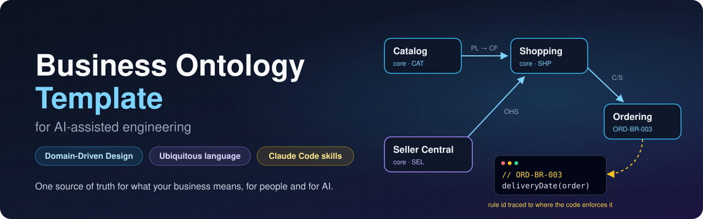

<p align="center">
  
</p>

# Business Ontology Template for AI-Assisted Engineering

A template for documenting the business ontology of any software project: its language, model, rules and
use cases. It follows the **strategic patterns of Domain-Driven Design**, and comes with tools and
**Claude Code skills**, so that people and Claude can create it, edit it, understand it, and implement
code from it.

## Why this project helps

Every software system encodes business knowledge: what an "order" is, when a discount applies, who may
approve a seller. That knowledge rarely lives in one place. It is spread across the heads of domain
experts, out-of-date requirement documents, ticket comments and, most of all, the code itself, where it
is implicit, scattered and mixed with technical detail.

AI coding assistants make that gap more costly. An assistant reads the code, not the intent behind it.
Asked to change behaviour, it can produce code that compiles and looks right, yet:
- quietly breaks a business rule it never saw;
- reuses a word that means something else in another part of the system;
- couples two areas the architecture meant to keep apart;
- leaves the documentation further behind than before.

This project closes that gap with a **business ontology**: a precise, versioned description of the
domain that lives next to the code and is written for people and for AI at once.

| Without it | With it |
| --- | --- |
| Rules are buried in `if` statements across many files | Each rule is stated once, with an id (`ORD-BR-003`), a status, and the file that enforces it |
| "Order" means three things, depending on who you ask | Each bounded context has its own ubiquitous language; the glossary records where words differ |
| Module boundaries erode one import at a time | The context map declares which contexts may depend on which; `ontology.mjs boundaries` checks real imports against it |
| Docs describe the system as it was meant to be, or as it was last year | Every rule and use case says whether it is `implemented`, `partial` or `not-implemented`; the validator flags code references that no longer exist |
| An AI assistant guesses at business behaviour | Claude Code reads the relevant context, cites rule ids in code and tests, and updates the ontology in the same change |
| Reviews check style, not business meaning | `ontology-review` checks a diff against the rules, boundaries and language it touches |

### Who it is for

- **Engineers** get answers to "where does this belong?" and "what must stay true?" before they write
  code, and they can see what a change affects (`affected --git main`).
- **Product owners and analysts** get requirements that stay connected to what is actually built, with
  gaps visible instead of hidden.
- **QA** gets testable rules with exact boundaries, and a coverage report per rule.
- **New team members** learn the domain in its own words, one bounded context at a time.
- **AI assistants** get a compact, structured, cross-referenced source of truth that fits in context and
  can be queried (`ontology.mjs show <id>`), so they stop reverse-engineering intent from code.

### Proven on a real codebase

The [HexCommerce example](example/hex-commerce/README.md) was built from a real Next.js marketplace. It
yielded 9 bounded contexts, 125 rules and 36 use cases, each traced to code. Building it also surfaced
real defects and design issues in the application: a wish-list move that silently drops items, a
checkout that can lose a seller's sale, and an undeclared dependency between two contexts. These are now
recorded with evidence, instead of waiting to be rediscovered.

## What's in the repository

```text
ontology-template-ai-engineering/
├── template/                       the reusable template
│   ├── ontology/                   copy into a project as ./ontology
│   │   ├── 00-meta/                conventions (the spec), maintenance, extraction playbook, changelog, decisions/
│   │   ├── 01-domain/              problem space: vision, subdomains, actors, glossary
│   │   ├── 02-context-map/         solution space: context map, cross-context flows
│   │   ├── 03-bounded-contexts/
│   │   │   └── _context-template/  one folder per bounded context, copied from here
│   │   ├── tools/                  validate.mjs, ontology.mjs (CLI), lib.mjs — Node 18+, no dependencies
│   │   ├── README.md               index
│   │   └── CLAUDE.md               how Claude Code uses and maintains it
│   ├── .claude/skills/ontology-*/  13 Claude Code skills
│   └── CLAUDE.snippet.md           paste into a project's root CLAUDE.md
├── example/
│   └── hex-commerce/               the template filled in from a real Next.js marketplace
└── .claude/skills/                 the same skills, plus ontology-template-evolve for this repository
```

## How DDD maps onto the folders

| DDD concept | Where it lives |
| --- | --- |
| Domain vision statement | `01-domain/domain-vision.md` |
| Subdomains (core, supporting, generic) | `01-domain/subdomains.md` |
| Bounded contexts | `03-bounded-contexts/<context>/`: one folder each, with an identical file set |
| Ubiquitous language (per context) | `03-bounded-contexts/<context>/ubiquitous-language.md` |
| Context map and relationship patterns | `02-context-map/context-map.md` |
| Cross-context processes | `02-context-map/cross-context-flows.md` |
| Use cases (actor goals) | `03-bounded-contexts/<context>/use-cases.md` |
| Tactical model | `aggregates/`, `value-objects.md`, `business-rules.md`, `commands.md`, `domain-events.md`, `read-models.md` |
| Design decisions | `00-meta/decisions/ADR-NNN-*.md` |

## Skills

| Discover | Maintain | Build |
| --- | --- | --- |
| `ontology-extract`: from code | `ontology-scaffold`: add, rename, deprecate with the right ids | `ontology-implement`: code a change from the model |
| `ontology-from-requirements`: from BRD, PRD, stories | `ontology-sync`: update the ontology after a code change | `ontology-tests`: tests from rules and use cases |
| `ontology-workshop`: Event Storming with the user | `ontology-reconcile`: code ↔ ontology ↔ requirements | `ontology-review`: review a diff against the model |
| `ontology-use-cases`: find and write use cases | | |
| `ontology-rule-miner`: find rules hidden in code | | |
| `ontology-language`: terminology audit | | |
| `ontology-boundaries`: coupling and the context map | | |

The skills share one CLI, `ontology/tools/ontology.mjs`:

| Group | Commands |
| --- | --- |
| Query | `show`, `find`, `refs`, `stats`, `export` |
| Scaffold | `next-id`, `new-context`, `new-aggregate`, `new-decision`, `rename` |
| Analyse the code | `affected` (impact of a diff), `coverage` (rules with tests), `gaps` (model completeness), `boundaries` (imports against the context map), `mine-rules` (rule-like code), `language` (avoided terms) |

## Using the skills

### How to invoke a skill

Claude Code loads skills from `.claude/skills/<name>/SKILL.md` in your project (for every project member),
or from `~/.claude/skills/<name>/` (for you only). Skills are read when a session starts, so start a new
session after copying them in.

There are two ways to use a skill:

- **Implicitly: just ask.** Each skill's `description` tells Claude when it applies. *"Add a rule to the
  ontology limiting deals to 30 days"* loads `ontology-scaffold`; *"review my branch"* loads `ontology-review`.
  This is convenient, but Claude chooses the skill.
- **Explicitly: name it.** Use this when you want a particular workflow, or when a request could match
  several skills.

#### Explicit invocation

**As a slash command.** Type `/` and the skill name. Anything after the name is passed to the skill as
its input:

```text
/ontology-implement Refuse expired cards at checkout (ORD-BR-016)
```

Type `/` on its own to see the available commands. The `ontology-*` skills appear in that list once
they are installed.

**By name in a prompt.** Mentioning the skill also selects it, and lets you add instructions:

```text
Use the ontology-rule-miner skill on src/components/seller only. Show me the table; don't apply anything yet.
```

#### Invocation reference

| Skill | Input it expects | Explicit example |
| --- | --- | --- |
| `ontology-extract` | Code location; optional requirement docs | `/ontology-extract src/ — the BRD is in docs/` |
| `ontology-from-requirements` | Documents or sections; the feature or scope | `/ontology-from-requirements docs/BRD_v3.docx, process P25 (returns)` |
| `ontology-workshop` | The journey or subdomain to explore | `/ontology-workshop seller payouts` |
| `ontology-use-cases` | A context, or "all" | `/ontology-use-cases SellerCentral` |
| `ontology-rule-miner` | A path to scan; whether to apply | `/ontology-rule-miner src/ — report only` |
| `ontology-language` | A context and/or a term | `/ontology-language Shopping: basket vs cart` |
| `ontology-boundaries` | Optional: contexts, or "generate lint rules" | `/ontology-boundaries and generate dependency-cruiser rules` |
| `ontology-scaffold` | The structural edit | `/ontology-scaffold rename Shopping.WishList to Shopping.Favourites` |
| `ontology-sync` | A base branch or commit, or files | `/ontology-sync main` |
| `ontology-reconcile` | A context or rule ids; the requirement source | `/ontology-reconcile Ordering against docs/BRD_v3.docx` |
| `ontology-implement` | The feature, fix or rule ids | `/ontology-implement let sellers cancel New orders (SEL-BR-024)` |
| `ontology-tests` | Rule or use-case ids, or a context | `/ontology-tests SHP-BR-009 to SHP-BR-014` |
| `ontology-review` | A PR number, branch range, or nothing (the working tree) | `/ontology-review main..feature/returns` |
| `ontology-template-evolve` (this repo only) | The format change | `/ontology-template-evolve add an optional Priority field to rules` |

Tips:

- **Chain skills explicitly** for a full cycle: `/ontology-implement …`, then `/ontology-tests …`, then
  `/ontology-review`.
- **Control how much a skill applies.** Skills that change meaning show a proposal and wait for you.
  Say *"apply directly"* to skip the wait, or *"report only"* to stop after the proposal.
- **If a skill does not appear** in the `/` list, check three things: the folder name equals the
  `name:` in its `SKILL.md`, the file is at `.claude/skills/<name>/SKILL.md`, and the session started
  after you copied it.

Every skill finds the ontology (the folder whose `README.md` has `type: index`, normally `ontology/`),
reads only the parts of the spec it needs, uses `ontology/tools/ontology.mjs` for the mechanical work,
and finishes with `validate.mjs`. Skills that change meaning (new rules, renamed terms, new boundaries)
show you a proposal first, and only apply it once you agree.

The examples below use the HexCommerce ontology in [`example/hex-commerce/`](example/hex-commerce/), so
every id is real.

### Three common workflows

**1. Adopt on an existing codebase.**

```text
You:    Build the ontology for this codebase.                      → ontology-extract
Claude: Proposes 9 contexts (Catalog, Shopping, Ordering, …) with evidence; waits for your OK;
        scaffolds them; writes language, aggregates, rules, use cases, the context map; runs
        validate, gaps and boundaries; reports defects found (e.g. SHP-BR-007 partial).
You:    Find any business rules it missed in src/.                  → ontology-rule-miner
You:    Check our terminology.                                       → ontology-language
```

**2. Build a feature.**

```text
You:    Let sellers cancel a New order with a reason.                → ontology-implement
Claude: Finds SellerCentral, SEL-UC-05 and SEL-BR-024 (partial); plans the change; implements it in the
        seller store with "// SEL-BR-024"; adds tests named "SEL-BR-024: …"; sets SEL-BR-024 to
        implemented, updates SEL-UC-05 and the SellerOrder lifecycle; validates.
You:    Write tests for the Shopping pricing rules.                  → ontology-tests
```

**3. Before you merge.**

```text
You:    Review this branch against the ontology.                     → ontology-review
You:    Update the ontology for what changed.                        → ontology-sync
```

### Each skill, with an example

#### Discover

**`ontology-extract`**: build the ontology from code.

> *"Build the ontology for this repo. The code is in `src/`, the BRD is in `docs/`."*

Claude inventories types, state changes, validation and routes, and proposes contexts with evidence.
After you confirm them, it scaffolds each one with `new-context`, fills every file, and reports
something like: *"9 contexts, 125 rules (98 implemented, 17 partial, 10 not-implemented), 36 use cases.
Likely bugs: SHP-BR-007, ORD-BR-010. Open questions: SHP-Q-01 …"*

**`ontology-from-requirements`**: model from documents, before or alongside code.

> *"We're adding returns. Model them from process P25 in the BRD."*

This adds a return-request model to Ordering, with rules marked `not-implemented` that cite their BRD ids
(BR-ORD-006, BR-ORD-012), use case ORD-UC-05 with its alternative flows, and open questions wherever the
document is ambiguous.

**`ontology-workshop`**: Event Storming with you as the domain expert.

> *"Let's event-storm how payouts to sellers should work."*

Claude asks 2–4 questions per round: events first ("Payout calculated"? "Payout sent"?), then their
order, commands, policies, rules, aggregates and boundaries. It summarises each phase for your OK, then
writes draft files. It uses the `eventstorming` MCP server when it is connected.

**`ontology-use-cases`**: find and write actor goals.

> *"Which use cases does SellerCentral have? Write any that are missing."*

Claude maps routes (`src/app/sell/(seller)/…/page.tsx`) to commands, groups them by goal (for example
SEL-UC-03 *Run a deal on a listing*), and takes alternative flows from validation messages ("This listing
already has a deal from …" becomes flow `2a.`). Afterwards, `ontology.mjs gaps` must show no command
without a use case.

**`ontology-rule-miner`**: find rules hidden in code, and check recorded ones for drift.

> *"Find business rules in src/ that the ontology doesn't record."*

Claude runs `mine-rules --path src --uncited` and triages each line, presenting a table like:

| Candidate | Proposed | Verdict |
| --- | --- | --- |
| `PasswordResetForm.tsx:19` email format | Account rule | new |
| `SellerDashboardView.tsx:47` Draft or Out of stock "needs attention" | SellerCentral rule | new |
| `ProductRail.tsx:35` `scrollLeft > 8` | — | not a rule (presentation) |

It adds the rules you accept, with ids from `next-id`.

**`ontology-language`**: terminology audit.

> *"Are we consistent about basket versus cart?"*

Claude runs `language --path src --context Shopping`, which reports "cart" with 89 hits in 25 files. It
separates true drift from legitimate homonyms (*order* versus *seller order*), and asks you to choose.
Once you have, it updates the ubiquitous language and the glossary. It lists code renames separately and
makes them only if you ask.

**`ontology-boundaries`**: coupling against the context map.

> *"Do our imports respect the context map?"*

On HexCommerce, `boundaries` reported that `CustomerServiceView.tsx` imports Shopping's store with no
relationship in the map. Claude proposed adding REL-15 (Conformist) and recording a known issue, with the
suggested fix: use the title already captured in `CustomerService.OrderedItem`. On request it can
generate `dependency-cruiser` or ESLint rules from the map.

#### Maintain

**`ontology-scaffold`**: safe structural edits.

> *"Add a rule to SellerCentral: a listing title is at most 200 characters."*

Claude runs `next-id rule SellerCentral` (→ `SEL-BR-030`), writes the block, links it from
`SellerCentral.SellerListing`, and validates. Other examples: *"Add a Payments context"*
(`new-context Payments --code PAY …`); *"Rename WishList to Favourites"* (`rename` with a dry run first);
*"Deprecate SEL-BR-009"*.

**`ontology-sync`**: update the ontology after a code change.

> *"I changed the free-delivery threshold logic. Update the ontology."*

Claude runs `affected --git main`. For `StoreProvider.tsx`, that lists the Shopping aggregates, 16 rules,
9 commands and 6 read models. Claude reads the diff, updates SHP-BR-010 and its status, and adds a
changelog line. If the code now contradicts an intended rule, it asks whether the rule changed, rather
than rewriting it.

**`ontology-reconcile`**: code against ontology against requirements, with evidence.

> *"Before the release, reconcile Ordering with the BRD."*

You get a table per rule and requirement: the ontology's verdict, the code's verdict, the proposed
status, and `file:line` evidence. For example, ORD-BR-003 is *partial* because there is no next-day
cut-off; BR-ORD-009 is *not implemented*. Statuses and *Known gaps* are updated once you agree.

#### Build

**`ontology-implement`**: code a change from the model.

> *"Refuse expired cards at checkout."*

Claude finds ORD-BR-016 (`not-implemented`), ACC-BR-006 and use case ORD-UC-01, alternative flow
`5b.`. It enforces the rule where the use case places it, comments `// ORD-BR-016`, adds tests, moves
ORD-BR-016 to `implemented`, removes it from *Known gaps*, and runs `validate` and `boundaries`.

**`ontology-tests`**: tests from rules and use cases.

> *"Write tests for SHP-BR-009 to SHP-BR-014."*

Claude detects the test framework, and proposes one if there is none (HexCommerce has none, so it asks
before adding vitest). It derives boundary cases from the rule statements: exactly 35.00 gives free
delivery, 34.99 costs 5.99, an empty basket costs nothing. Tests are named `SHP-BR-010: …`, so
`ontology.mjs coverage` counts them. A failing test that matches the rule is reported as a bug, not
"fixed".

**`ontology-review`**: review a diff against the model.

> *"/ontology-review"* on a branch that lets the basket hold 20 units.

> **Blocker**: `StoreProvider.tsx:67` changes `MAX_QUANTITY` to 20; SHP-BR-001 states 10, and the
> ontology was not updated. Intended? If so, update SHP-BR-001 and SHP-UC-01. **Major**: no test cites
> SHP-BR-001.

### Using the CLI without the skills

Everything the skills use is available directly:

```bash
node ontology/tools/ontology.mjs show SHP-BR-007          # print one rule
node ontology/tools/ontology.mjs find basket              # where a word is defined
node ontology/tools/ontology.mjs refs Ordering.OrderPlaced
node ontology/tools/ontology.mjs affected --git main      # what a diff touches
node ontology/tools/ontology.mjs gaps                     # model completeness
node ontology/tools/ontology.mjs boundaries               # imports against the context map
node ontology/tools/ontology.mjs                          # all commands
```

## Quick start

```bash
cp -r template/ontology  /path/to/your-project/ontology
cp -r template/.claude   /path/to/your-project/
cat template/CLAUDE.snippet.md >> /path/to/your-project/CLAUDE.md
node /path/to/your-project/ontology/tools/validate.mjs
```

Then, in Claude Code: *"Build the ontology from this codebase"* (`ontology-extract`), or follow
[`template/README.md`](template/README.md).

## The example

[`example/hex-commerce/`](example/hex-commerce/README.md) is a complete ontology of the HexCommerce
marketplace: 9 bounded contexts, 15 aggregates, 125 business rules, 36 use cases, 15 context
relationships and 3 decision records. Each item is tied to the code that implements it and, where one
exists, to the BRD requirement it comes from. The validator and every CLI analysis run cleanly against
the real source.
