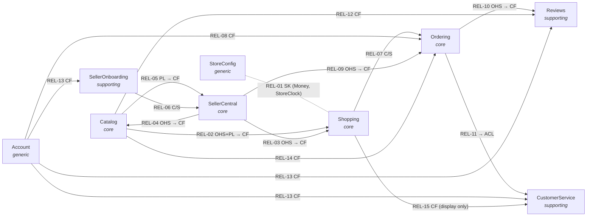

# Context map

## Diagram

Arrows point from upstream to downstream (model dependency). Labels give the patterns: upstream side
before the arrow, downstream side after it.

StoreConfig is a shared kernel with every context. Only one of those edges is drawn, to keep the diagram
readable.

## Relationships

| ID | Upstream | Downstream | Pattern | Contract (what crosses) | Translation | Code |
| --- | --- | --- | --- | --- | --- | --- |
| REL-01 | [StoreConfig](../03-bounded-contexts/store-config/README.md) | all other contexts | Shared Kernel + CF | `StoreConfig.Money`, `StoreConfig.StoreClock`, `StoreConfig.StoreSettings` | none | `src/lib/format.ts`, `src/lib/site.ts` |
| REL-02 | [Catalog](../03-bounded-contexts/catalog/README.md) | [Shopping](../03-bounded-contexts/shopping/README.md) | OHS + PL → CF | `Catalog.ProductLookup` returning `Catalog.Product` | none | `src/context/StoreProvider.tsx` (`getProduct`) |
| REL-03 | [SellerCentral](../03-bounded-contexts/seller-central/README.md) | [Shopping](../03-bounded-contexts/shopping/README.md) | OHS → CF | `SellerCentral.StorefrontProduct` (per listing) | in upstream (`toStorefrontProduct`) | `src/context/StoreProvider.tsx` (`getStorefrontProduct`) |
| REL-04 | [SellerCentral](../03-bounded-contexts/seller-central/README.md) | [Catalog](../03-bounded-contexts/catalog/README.md) | OHS → CF | `SellerCentral.StorefrontProducts`, `SellerCentral.StorefrontDeals` | in upstream | `src/components/catalog/MarketplaceResults.tsx`, `src/components/deals/SellerDealsSection.tsx` |
| REL-05 | [Catalog](../03-bounded-contexts/catalog/README.md) | [SellerCentral](../03-bounded-contexts/seller-central/README.md) | PL → CF | `Catalog.Product` shape; `Catalog.Department` taxonomy | SellerCentral translates listings *into* the PL | `src/data/seller.ts` (`toStorefrontProduct`) |
| REL-06 | [SellerOnboarding](../03-bounded-contexts/seller-onboarding/README.md) | [SellerCentral](../03-bounded-contexts/seller-central/README.md) | Customer–Supplier | `SellerOnboarding.SellerAccountStatus`, `SellerOnboarding.SellerProfile` | none | `src/context/SellerProvider.tsx` (`sellerProfile`) |
| REL-07 | [Shopping](../03-bounded-contexts/shopping/README.md) | [Ordering](../03-bounded-contexts/ordering/README.md) | Customer–Supplier | `Shopping.DetailedBasket`, `Shopping.BasketTotals`, `Shopping.StockProblems`; command `Shopping.ClearBasket` | Ordering snapshots lines into `Ordering.OrderItem` | `src/components/checkout/CheckoutView.tsx` |
| REL-08 | [Account](../03-bounded-contexts/account/README.md) | [Ordering](../03-bounded-contexts/ordering/README.md) | CF | `Account.DeliverTo`, `Account.SavedCards` | copied into `Ordering.AddressSnapshot`, `Ordering.PaymentSnapshot` | `src/components/checkout/CheckoutView.tsx` |
| REL-09 | [SellerCentral](../03-bounded-contexts/seller-central/README.md) | [Ordering](../03-bounded-contexts/ordering/README.md) | OHS → CF | command `SellerCentral.RecordSale` with `SellerCentral.SaleLine` | none | `src/components/checkout/CheckoutView.tsx` (`recordSale`) |
| REL-10 | [Ordering](../03-bounded-contexts/ordering/README.md) | [Reviews](../03-bounded-contexts/reviews/README.md) | OHS → CF | `Ordering.PurchaseCheck` | none | `src/components/product/ReviewsSection.tsx` (`hasPurchased`) |
| REL-11 | [Ordering](../03-bounded-contexts/ordering/README.md) | [CustomerService](../03-bounded-contexts/customer-service/README.md) | ACL (downstream) | `Ordering.OrderHistory` | into `CustomerService.OrderedItem` | `src/data/support.ts` (`getOrderedItems`) |
| REL-12 | [Catalog](../03-bounded-contexts/catalog/README.md) | [Reviews](../03-bounded-contexts/reviews/README.md) | CF | product id, baseline `rating` and `reviewCount` of `Catalog.Product` | none | `src/components/product/ReviewsSection.tsx` |
| REL-13 | [Account](../03-bounded-contexts/account/README.md) | CustomerService, Reviews, SellerOnboarding | CF | `Account.CurrentShopper` | none | `src/data/account.ts` (`currentUser`) |
| REL-14 | [Catalog](../03-bounded-contexts/catalog/README.md) | [Ordering](../03-bounded-contexts/ordering/README.md) | CF | `Catalog.ProductLookup`, for orders without captured prices | none | `src/data/account.ts` (`getOrderTotals`) |
| REL-15 | [Shopping](../03-bounded-contexts/shopping/README.md) | [CustomerService](../03-bounded-contexts/customer-service/README.md) | CF | `Shopping.PurchasableItem` lookup, for item titles and pictures in issues | none | `src/components/support/CustomerServiceView.tsx` (`useStore`) |

## Shared kernel

| What | Owner | Shared with | Change rule |
| --- | --- | --- | --- |
| `StoreConfig.Money` (rounding, formatting) | StoreConfig | all contexts | Change only with every context owner's agreement; amounts are plain numbers everywhere |
| `StoreConfig.StoreClock` | StoreConfig | SellerCentral, Ordering, Account | Same. Replacing the fixed clock (CFG-BR-005) affects every date rule. |

`src/lib/types.ts` holds the types of *every* context in one file. That is a code-organisation choice,
not a shared kernel: each type belongs to the context named in its aggregate file.

## Integration style

- **One process, no messaging.** Every context runs in the browser. Integration is by synchronous
  function calls and React context reads; nothing is sent over a network.
- **Providers are nested by dependency** in `src/app/layout.tsx`: SellerApplicationProvider (SellerOnboarding)
  ⊃ SellerProvider (SellerCentral) ⊃ StoreProvider (Shopping) ⊃ AccountProvider (Account and Ordering).
  Each provider may read only the providers outside it, so the nesting order *is* the upstream order for
  REL-03 and REL-06.
- **Events are implicit.** A downstream context sees an upstream change on its next render. The only
  explicit hand-overs are the calls `placeOrder` makes at checkout (see
  [FLOW-02](cross-context-flows.md#flow-02-buy-the-basket)).

## Known issues

| Issue | Relationships | Effect | Direction for the target state |
| --- | --- | --- | --- |
| **Mutual dependency between Catalog and SellerCentral** (ADR-003) | REL-04, REL-05 | Each depends on the other's model | Treat `Catalog.Product` as a separate published "storefront product" contract that both conform to |
| **Ordering is hosted in the Account store** | REL-08 | Order logic sits next to the address book | Give Ordering its own store |
| **Checkout is a non-atomic saga** | REL-07, REL-09 | A failed `recordSale` still places the order (ORD-BR-010) | Make placement transactional, or compensate |
| **No back-propagation of fulfilment** | REL-09 | Seller dispatch never updates the shopper's order (ORD-BR-013) | `SellerCentral.SellerOrderDispatched` → Ordering policy |
| **CustomerService and Reviews keep their stores in UI components** | REL-10, REL-11 | Other screens cannot read issues or reviews | Lift the stores into providers |
| **CustomerService reads item details from Shopping** (found by `ontology.mjs boundaries`) | REL-15 | Issues about an item that is no longer sold lose their picture, and depend on the basket's lookup | Use the title captured in `CustomerService.OrderedItem`, and drop REL-15 |
