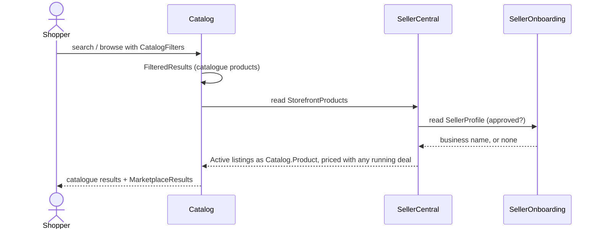
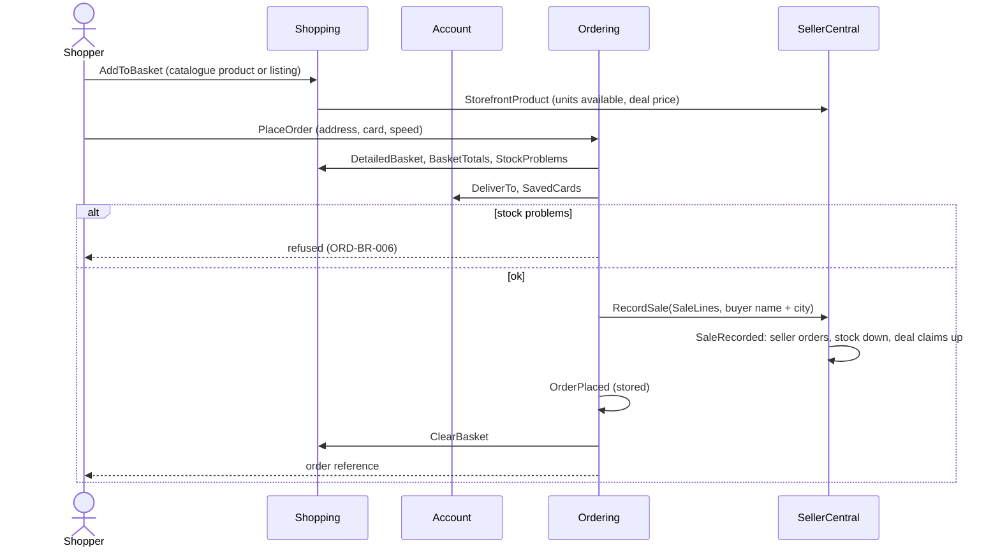
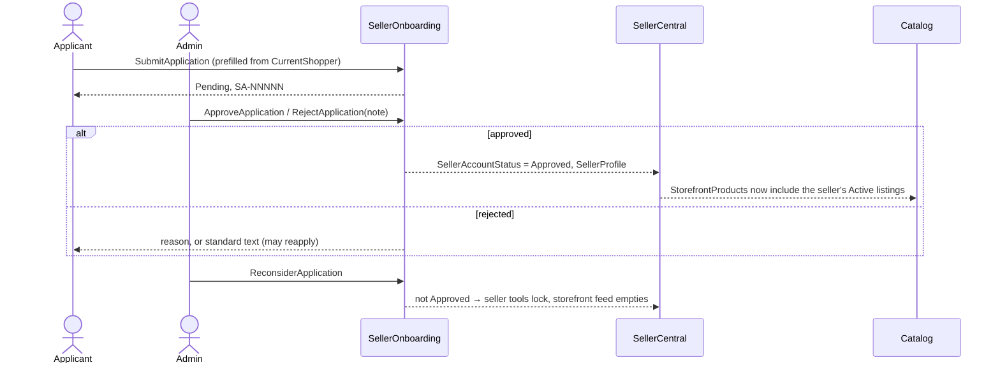
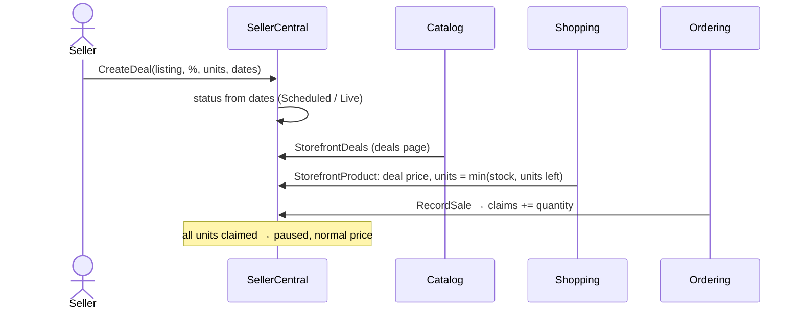
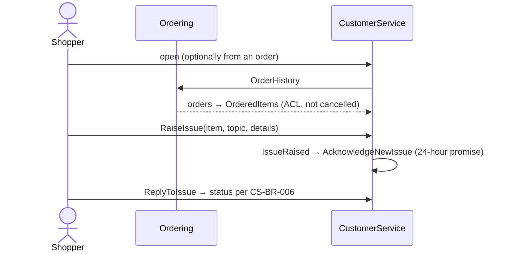
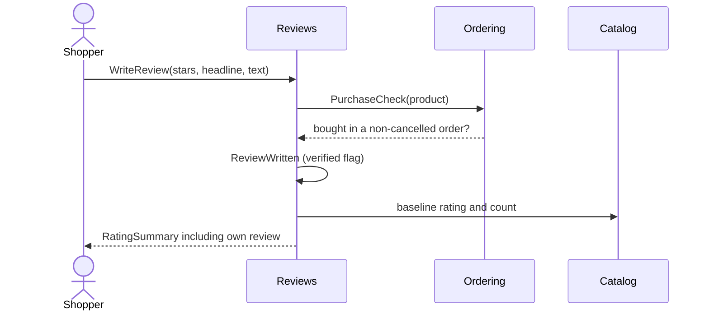

# Cross-context flows

The business journeys that cross bounded contexts. Each step names the command, event or read model, and
the rules that apply. Behaviour inside a single context is in that context's folder.

## FLOW-01 Discover products

- **Trigger:** A shopper searches, opens a department, or browses deals.
- **Outcome:** The shopper sees matching catalogue products and seller listings, at today's prices.
- **Contexts:** Catalog, SellerCentral, SellerOnboarding
- **Relationships used:** REL-04, REL-05, REL-06

| Step | Context | Command / event / read model | Rules applied |
| --- | --- | --- | --- |
| 1 | Catalog | `Catalog.SearchResults` / `Catalog.FilteredResults` | CAT-BR-005, CAT-BR-006, CAT-BR-007, CAT-BR-004 |
| 2 | SellerOnboarding | `SellerOnboarding.SellerProfile` | SON-BR-004 |
| 3 | SellerCentral | `SellerCentral.StorefrontProducts` | SEL-BR-003, SEL-BR-019, SEL-BR-027 |
| 4 | Catalog | `Catalog.MarketplaceResults` | CAT-BR-012 |

**Failure paths:** If the seller is not approved, the feed is empty and only catalogue results show.

## FLOW-02 Buy the basket

- **Trigger:** A shopper places an order at checkout.
- **Outcome:** An order exists with a snapshot of what was bought. Each marketplace line is a seller order,
  with listing stock and deal claims updated. The basket is empty.
- **Contexts:** Shopping, Account, Ordering, SellerCentral
- **Relationships used:** REL-02, REL-03, REL-07, REL-08, REL-09

| Step | Context | Command / event / read model | Rules applied |
| --- | --- | --- | --- |
| 1 | Shopping | `Shopping.AddToBasket` | SHP-BR-001, SHP-BR-002, SHP-BR-003 |
| 2 | Shopping | `Shopping.BasketTotals` | SHP-BR-009 to SHP-BR-014 |
| 3 | Ordering | `Ordering.PlaceOrder` | ORD-BR-006, ORD-BR-017, ORD-BR-003, ORD-BR-004 |
| 4 | SellerCentral | `SellerCentral.RecordSaleOnOrderPlaced` → `SellerCentral.RecordSale` | SEL-BR-025, SEL-BR-005, SEL-BR-020, ORD-BR-010 |
| 5 | Ordering | `Ordering.OrderPlaced` | ORD-BR-001, ORD-BR-002, ORD-BR-005 |
| 6 | Shopping | `Shopping.ClearBasketAfterOrder` → `Shopping.ClearBasket` | — |

**Failure paths:** Stock problems block step 3. If SellerCentral cannot save at step 4, the order is still
placed and the seller orders are lost (ORD-BR-010, partial). No payment is taken (ORD-BR-012).

## FLOW-03 Become a seller

- **Trigger:** A shopper applies to sell.
- **Outcome:** Once approved, the shopper can use the seller tools, and their Active listings are sold in
  the storefront.
- **Contexts:** Account, SellerOnboarding, SellerCentral, Catalog
- **Relationships used:** REL-13, REL-06, REL-04

| Step | Context | Command / event / read model | Rules applied |
| --- | --- | --- | --- |
| 1 | SellerOnboarding | `SellerOnboarding.SubmitApplication` | SON-BR-001, SON-BR-002, SON-BR-005, SON-BR-010 |
| 2 | SellerOnboarding | `SellerOnboarding.ApproveApplication` / `SellerOnboarding.RejectApplication` | SON-BR-003, SON-BR-007 |
| 3 | SellerOnboarding | `SellerOnboarding.SellerProfile` | SON-BR-008 |
| 4 | SellerCentral | `SellerCentral.StorefrontProducts` | SEL-BR-027 |
| 5 | SellerCentral | `SellerCentral.WithdrawStorefrontWhenNotApproved` | SON-BR-004, SEL-BR-027 |

**Failure paths:** Nothing restricts who can decide (SON-BR-011). What happens to an un-approved seller's
open orders is open (SON-Q-01).

## FLOW-04 Run a seller deal

- **Trigger:** A seller creates a deal on an Active listing.
- **Outcome:** While the deal runs, shoppers see and pay the deal price for up to the remaining deal
  units. Each unit bought counts as claimed.
- **Contexts:** SellerCentral, Catalog, Shopping, Ordering
- **Relationships used:** REL-03, REL-04, REL-09

| Step | Context | Command / event / read model | Rules applied |
| --- | --- | --- | --- |
| 1 | SellerCentral | `SellerCentral.CreateDeal` | SEL-BR-010 to SEL-BR-014, SEL-BR-022 |
| 2 | SellerCentral | `SellerCentral.RunningDeal` | SEL-BR-016, SEL-BR-017, SEL-BR-018 |
| 3 | SellerCentral | `SellerCentral.StorefrontProduct`, `SellerCentral.StorefrontDeals` | SEL-BR-015, SEL-BR-019 |
| 4 | Shopping | `Shopping.UnitsAvailable` | SHP-BR-002 |
| 5 | SellerCentral | `SellerCentral.RecordSale` | SEL-BR-020 |

**Failure paths:** A Live deal on an unpublished or sold-out listing is paused, and the seller sees why
(`SellerCentral.DealPausedReason`). Because the store clock is fixed (CFG-BR-005), a scheduled deal only
starts when the seller starts it early.

## FLOW-05 Get help with an ordered item

- **Trigger:** A shopper raises an issue, or chooses "Return or replace items" on a delivered order.
- **Outcome:** An acknowledged issue the shopper and support can discuss.
- **Contexts:** Ordering, CustomerService, Account
- **Relationships used:** REL-11, REL-13

| Step | Context | Command / event / read model | Rules applied |
| --- | --- | --- | --- |
| 1 | CustomerService | `CustomerService.ContactableItems` | CS-BR-001 |
| 2 | CustomerService | `CustomerService.RaiseIssue` | CS-BR-002, CS-BR-003, CS-BR-004, CS-BR-008 |
| 3 | CustomerService | `CustomerService.AcknowledgeNewIssue` | CS-BR-005 |
| 4 | CustomerService | `CustomerService.ReplyToIssue` | CS-BR-006, CS-BR-007, CS-BR-010 |

**Failure paths:** Cancelled orders offer no items. Agent replies are not built (CS-BR-009).

## FLOW-06 Review a product

- **Trigger:** A shopper writes a review on a catalogue product page.
- **Outcome:** A published review, marked verified when the shopper bought the product, and an updated
  average rating.
- **Contexts:** Ordering, Reviews, Catalog, Account
- **Relationships used:** REL-10, REL-12, REL-13

| Step | Context | Command / event / read model | Rules applied |
| --- | --- | --- | --- |
| 1 | Reviews | `Reviews.WriteReview` | REV-BR-001, REV-BR-002, REV-BR-003 |
| 2 | Ordering | `Ordering.PurchaseCheck` | ORD-BR-009, REV-BR-004 |
| 3 | Reviews | `Reviews.RatingSummary` | REV-BR-006, REV-BR-007 |

**Failure paths:** Validation refuses the review. Seller listings cannot be reviewed (REV-BR-010).
