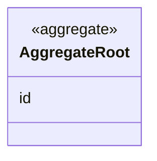

# <Context> context

<!--
This README is the bounded context canvas: the one page someone reads before touching this context.
Keep it to what a newcomer needs. Details go in the other files of this folder.
-->

## Purpose

<!-- 2–3 sentences: why this context exists, in business terms. -->

## Strategic classification

| Aspect | Value |
| --- | --- |
| Subdomain | `SD-<NAME>` (core / supporting / generic) |
| Business objectives served | BO-01 |
| Domain role | <e.g. execution, analysis, gateway, specification, draft> |
| Owner | <team or role> |

## Responsibilities

**This context is responsible for:**
- <Responsibility>

**This context is deliberately not responsible for:**
<!-- Explicit non-responsibilities stop logic from leaking in. Name the context that IS responsible. -->
- <Thing> — owned by [<OtherContext>](../<other-context>/README.md)

## Model overview

<!-- Aggregates and their references to each other (by ID only). Details in aggregates/. -->

| Aggregate | In one line | File |
| --- | --- | --- |
| `<Context>.<Aggregate>` | <line> | [aggregates/<aggregate>.md](aggregates/<aggregate>.md) |

## Contents

| File | What it holds |
| --- | --- |
| [ubiquitous-language.md](ubiquitous-language.md) | Terms of this context and their code identifiers |
| [aggregates/](aggregates/) | One file per aggregate: structure, invariants, lifecycle |
| [value-objects.md](value-objects.md) | Value objects shared by several aggregates of this context |
| [business-rules.md](business-rules.md) | Every rule, with status and code location |
| [commands.md](commands.md) | What actors can ask this context to do |
| [domain-events.md](domain-events.md) | What happens here that matters, and policies that react |
| [read-models.md](read-models.md) | Questions this context answers |

## Relationships

<!-- Mirror of this context's rows in the context map. Use the REL IDs. -->

| REL | Direction | Other context | Pattern | What crosses |
| --- | --- | --- | --- | --- |
| REL-01 | upstream of / downstream of | [<Other>](../<other>/README.md) | <Pattern> | <Contract> |

## Actors

| Actor | What they do here |
| --- | --- |
| ACT-<NAME> | <Commands they issue> |

## Code map

<!-- Where the concepts of this context live in code. Paths relative to code_root. -->

| Concept | Code location | Notes |
| --- | --- | --- |
| `<Context>.<Aggregate>` | `<path/to/file>` (`<Symbol>`) | |

### Implementation notes

<!-- Where physical structure differs from the logical model (shared stores, mixed modules, etc.). -->

## Known gaps

<!-- Intended behaviour the code does not meet yet. Link the rules marked partial / not-implemented. -->

| Gap | Rules | Impact |
| --- | --- | --- |
| <Gap> | <CTX>-BR-001 | <Impact> |

## Open questions

| ID | Question | Raised | Owner |
| --- | --- | --- | --- |
| <CTX>-Q-01 | <Question> | YYYY-MM-DD | <Who decides> |
