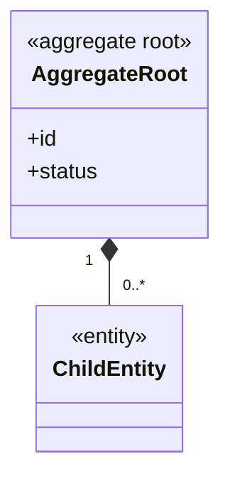
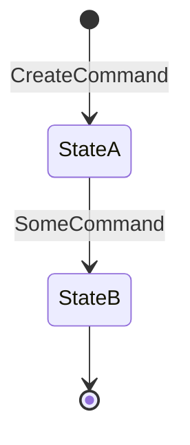

# <AggregateRoot> (aggregate)

<!--
One file per aggregate. Name the file after the root in kebab-case (aggregates/seller-listing.md).
Every ### heading in this file defines a concept <Context>.<Name>, so use ### only for the root, its
entities and its private value objects.
-->

## Definition

<!-- What it is, in one paragraph a domain expert would sign off. What consistency it protects. -->

## Structure



### <AggregateRoot>

Root entity. Identity: <how it is identified, e.g. reference format>.

| Attribute | Type | Required | Meaning | Code |
| --- | --- | --- | --- | --- |
| id | <Identifier> | yes | <Meaning> | `id` |
| status | `<Context>.<Status>` | yes | Lifecycle state, see below | `status` |

### <ChildEntity>

<!-- Entity inside the aggregate. Delete if none. -->

| Attribute | Type | Required | Meaning | Code |
| --- | --- | --- | --- | --- |
| | | | | |

## Invariants

<!-- Rules that must hold after every command. Link to business-rules.md; do not restate them in full. -->

- <CTX>-BR-001 — <short title>

## Lifecycle

<!-- Delete this section if the aggregate has no states. -->



| From | To | Triggered by | Guard (rule) |
| --- | --- | --- | --- |
| — | StateA | `<Context>.<Command>` | <CTX>-BR-001 |

## Behaviour

| Commands handled | Events emitted |
| --- | --- |
| `<Context>.<Command>` | `<Context>.<Event>` |

## References to other aggregates

<!-- By ID only, never by holding the other object. -->

| Reference | Points to | Cardinality | Notes |
| --- | --- | --- | --- |
| <field> | `<OtherContext>.<Aggregate>` | many to 1 | |

## Example

<!-- A realistic instance. It anchors the definitions for readers and for Claude Code. -->

```json
{}
```

## Implementation

<!-- Where it lives, how it is persisted, and any differences from the model above. -->

- **Type / class:** `<path>` (`<Symbol>`)
- **State changes:** `<path>` (`<function or reducer>`)
- **Persistence:** <where and how>
