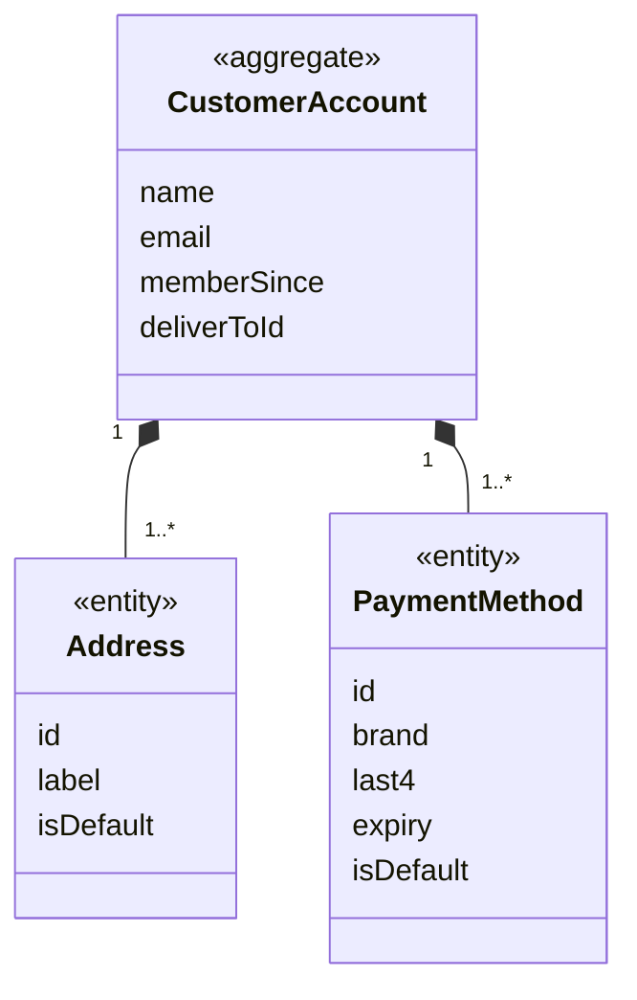

# Account context

## Purpose

Account knows who the shopper is and keeps their **account book**: saved delivery addresses, saved
cards, and the address currently chosen to deliver to. Checkout starts from these choices, and other
contexts use the shopper's name and email.

## Strategic classification

| Aspect | Value |
| --- | --- |
| Subdomain | `SD-CUSTOMER-ACCOUNTS` (generic) |
| Business objectives served | BO-02, BO-10 |
| Domain role | Specification: supplies choices that other contexts copy |
| Owner | Product Owner; card and personal data: Security / data protection lead |

## Responsibilities

**This context is responsible for:**
- the signed-in shopper's identity (name, email, member-since date);
- the address book, with exactly one default address and a current "deliver to" address;
- saved cards, kept masked, with exactly one default card;
- the shopper's recently viewed items.

**This context is deliberately not responsible for:**
- orders. They are stored in the same client store (`AccountProvider`), but they belong to
  [Ordering](../ordering/README.md).
- registration, sign-in, sign-out and password reset. These are not built; one shopper is always
  signed in.
- card data beyond brand, last four digits and expiry. That belongs to the payment service provider in
  the target state.

## Model overview

| Aggregate | In one line | File |
| --- | --- | --- |
| `Account.CustomerAccount` | The shopper, their address book and saved cards | [aggregates/customer-account.md](aggregates/customer-account.md) |

## Contents

| File | What it holds |
| --- | --- |
| [ubiquitous-language.md](ubiquitous-language.md) | Terms of this context and their code identifiers |
| [aggregates/](aggregates/) | `CustomerAccount` |
| [value-objects.md](value-objects.md) | `CardBrand`, `CardExpiry` |
| [business-rules.md](business-rules.md) | Defaults, last-entry protection, address and card validation |
| [use-cases.md](use-cases.md) | Actor goals this context serves, step by step |
| [commands.md](commands.md) | Address book and card commands |
| [domain-events.md](domain-events.md) | Account book events |
| [read-models.md](read-models.md) | `CurrentShopper`, `DeliverTo`, `SavedCards`, `RecentlyViewed` |

## Relationships

| REL | Direction | Other context | Pattern | What crosses |
| --- | --- | --- | --- | --- |
| REL-08 | upstream of | [Ordering](../ordering/README.md) | CF | `Account.DeliverTo`, `Account.SavedCards`, copied into the order |
| REL-13 | upstream of | [CustomerService](../customer-service/README.md), [Reviews](../reviews/README.md), [SellerOnboarding](../seller-onboarding/README.md) | CF | `Account.CurrentShopper` |

## Actors

| Actor | What they do here |
| --- | --- |
| ACT-SHOPPER | Every command in this context |

## Code map

| Concept | Code location | Notes |
| --- | --- | --- |
| `Account.CustomerAccount` | `src/context/AccountProvider.tsx` (reducer), `src/lib/types.ts` (`Address`, `PaymentMethod`, `User`) | |
| Address validation | `src/components/account/AddressBook.tsx` | |
| Card validation and brand | `src/components/account/PaymentMethodsCard.tsx` (`detectBrand`) | |
| Deliver-to choice | `src/components/layout/DeliverToMenu.tsx` | |
| Shopper and seed data | `src/data/account.ts` (`currentUser`, `addresses`, `paymentMethods`, `recentlyViewedIds`) | |

### Implementation notes

- `AccountProvider` also stores placed orders, which belong to Ordering (see the Ordering README).
- An older `localStorage` key, `hexcommerce.deliverTo.v1`, is read once to carry over a delivery-address
  choice made before the account store existed.

## Known gaps

| Gap | Rules | Impact |
| --- | --- | --- |
| No authentication | ACC-BR-009 | Anyone using the browser is "the shopper" |
| A card that expires after being saved stays usable and can stay the default | ACC-BR-006 | Checkout can use an expired card (ORD-BR-016) |

## Open questions

| ID | Question | Raised | Owner |
| --- | --- | --- | --- |
| ACC-Q-01 | A shopper must keep at least one card. Is that right for shoppers who would rather not store a card? | 2026-10-27 | Product Owner |
