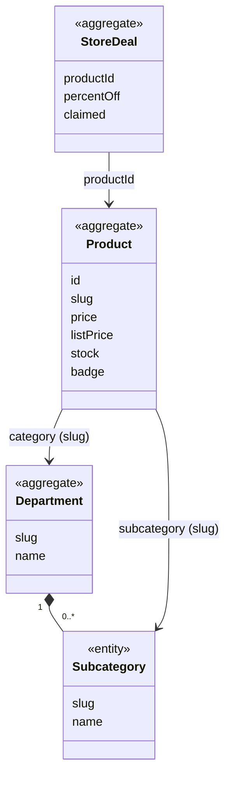

# Catalog context

## Purpose

Catalog holds the store's own products, organised into departments and subcategories, and answers every
question about *finding* something to buy: search, filters, sort orders, related products, best sellers
and deals. It also defines the **Product** shape that the storefront sells. Seller listings are
translated into that shape, which lets shoppers discover and buy them like catalogue products.

## Strategic classification

| Aspect | Value |
| --- | --- |
| Subdomain | `SD-DISCOVERY` (core) |
| Business objectives served | BO-01, BO-03, BO-07 |
| Domain role | Analysis (queries) and specification (owns the Product published language) |
| Owner | Product Owner; merchandising content: Merchandising lead |

## Responsibilities

**This context is responsible for:**
- the catalogue products, departments and subcategories (reference data);
- search, suggestions, faceted filtering, sort orders and pagination of results;
- curation: best sellers, top discounts, badged products, related products, store deals and home-page
  merchandising;
- the published language `Catalog.Product`, which every storefront item conforms to.

**This context is deliberately not responsible for:**
- seller listings, their prices and their deals. Those are owned by
  [SellerCentral](../seller-central/README.md), which feeds them in as `Catalog.Product`.
- how many units a shopper may buy. That is owned by [Shopping](../shopping/README.md).
- customer reviews and the shopper's own ratings. Those are owned by [Reviews](../reviews/README.md).
  The catalogue only carries each product's baseline average rating and rating count.

## Model overview

| Aggregate | In one line | File |
| --- | --- | --- |
| `Catalog.Product` | Something the store sells, with price, stock and descriptive content | [aggregates/product.md](aggregates/product.md) |
| `Catalog.Department` | Top-level grouping of products, with subcategories | [aggregates/department.md](aggregates/department.md) |
| `Catalog.StoreDeal` | A store-run, time-limited "lightning deal" on one catalogue product | [aggregates/store-deal.md](aggregates/store-deal.md) |

## Contents

| File | What it holds |
| --- | --- |
| [ubiquitous-language.md](ubiquitous-language.md) | Terms of this context and their code identifiers |
| [aggregates/](aggregates/) | `Product`, `Department`, `StoreDeal` |
| [value-objects.md](value-objects.md) | `Badge`, `StockLevel`, `CatalogFilters`, `SortOrder`, `PriceBand` |
| [business-rules.md](business-rules.md) | Discounts, ranking, search, filters, stock levels |
| [use-cases.md](use-cases.md) | Actor goals this context serves, step by step |
| [commands.md](commands.md) | None as-built: the catalogue is static |
| [domain-events.md](domain-events.md) | None as-built |
| [read-models.md](read-models.md) | Lookup, search, filtering, curation, deals |

## Relationships

| REL | Direction | Other context | Pattern | What crosses |
| --- | --- | --- | --- | --- |
| REL-01 | downstream of | [StoreConfig](../store-config/README.md) | SK + CF | `StoreConfig.Money`, free-delivery threshold |
| REL-02 | upstream of | [Shopping](../shopping/README.md) | OHS + PL → CF | `Catalog.ProductLookup` returning `Catalog.Product` |
| REL-04 | downstream of | [SellerCentral](../seller-central/README.md) | OHS → CF | `SellerCentral.StorefrontProducts`, `SellerCentral.StorefrontDeals` |
| REL-05 | upstream of | [SellerCentral](../seller-central/README.md) | PL → CF | `Catalog.Product` shape, department taxonomy |
| REL-12 | upstream of | [Reviews](../reviews/README.md) | CF | Product id, baseline `rating` and `reviewCount` |
| REL-14 | upstream of | [Ordering](../ordering/README.md) | CF | `Catalog.ProductLookup` for orders placed before prices were captured |

## Actors

| Actor | What they do here |
| --- | --- |
| ACT-SHOPPER | Searches, filters, sorts and browses |
| ACT-VISITOR | The same as a shopper, in the target state |
| ACT-CATALOGUE-MANAGER, ACT-MERCHANDISER | Maintain products, badges, store deals and promotions: target state, no commands yet |

## Code map

| Concept | Code location | Notes |
| --- | --- | --- |
| `Catalog.Product` | `src/lib/types.ts` (`Product`), `src/data/products.ts` (41 products) | |
| `Catalog.Department` | `src/lib/types.ts` (`Category`), `src/data/categories.ts` | Code says *category*; the business says *department* |
| `Catalog.StoreDeal` | `src/lib/types.ts` (`Deal`), `src/data/marketing.ts` (`deals`) | |
| Search, filters, sort | `src/lib/catalog.ts` (`searchProducts`, `filterProducts`, `applySort`) | |
| Filters in the URL | `src/lib/searchParams.ts` (`parseFilters`, `buildUrl`) | Presentation of `Catalog.CatalogFilters` |
| Marketplace results | `src/components/catalog/MarketplaceResults.tsx` | Applies the same facets to seller listings |
| Home merchandising | `src/data/marketing.ts` (`heroSlides`, `promoTiles`) | |

### Implementation notes

- Catalogue data is a static, server-side array. Seller listings live in the browser, so search and
  department pages show matching listings in a separate client-rendered section rather than ranked
  together with catalogue products.
- Catalogue products are addressed by `slug` (`/product/[slug]`), seller listings by `id`
  (`/listing/[id]`). `productHref` picks the right one.

## Known gaps

| Gap | Rules | Impact |
| --- | --- | --- |
| Products have no publish date, so "newest" is the reverse of catalogue order | CAT-BR-009 | Newest-arrivals sort is not truthful |
| Store deals do not change the price and count down from a fixed label | CAT-BR-014 | The advertised discount and countdown are marketing copy, not rules |
| No check that a subcategory belongs to its department | CAT-BR-015 | Holds only because the data and the listing editor happen to respect it |
| No catalogue maintenance (BRD P30), merchandising maintenance or store-deal maintenance (P29) | — | Catalogue changes need a code change |

## Open questions

| ID | Question | Raised | Owner |
| --- | --- | --- | --- |
| CAT-Q-01 | Should seller listings be ranked together with catalogue products in search, rather than shown as a separate section? | 2026-10-27 | Product Owner |
| CAT-Q-02 | The subcategory is scored in search but is not part of the "every term must match" text (CAT-BR-005). Is that intended? | 2026-10-27 | Product Owner |
