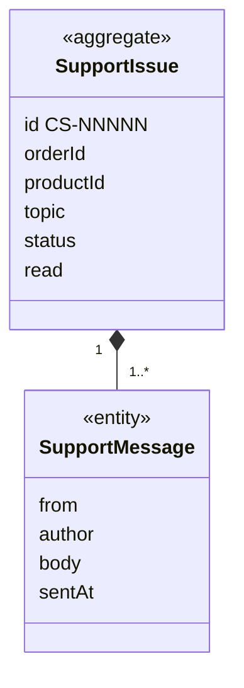

# CustomerService context

## Purpose

CustomerService lets a shopper raise a problem about something they ordered and talk it through with the
support team in a message thread, until the issue is resolved. Every issue is about one item from one
order.

## Strategic classification

| Aspect | Value |
| --- | --- |
| Subdomain | `SD-CUSTOMER-CARE` (supporting) |
| Business objectives served | BO-04 |
| Domain role | Execution (case handling) |
| Owner | Customer service lead |

## Responsibilities

**This context is responsible for:**
- support issues, their topics, statuses and message threads;
- which ordered items an issue may be raised about;
- the acknowledgement and the 24-hour reply promise;
- telling the shopper when there is a reply they have not read.

**This context is deliberately not responsible for:**
- orders and their contents. Those are owned by [Ordering](../ordering/README.md); this context
  translates them into `CustomerService.OrderedItem`.
- returns, refunds and cancellations. These are not built; a return is requested as an issue with the
  topic "Request a return".
- the support agent's console. This is not built (BRD P22).

## Model overview

| Aggregate | In one line | File |
| --- | --- | --- |
| `CustomerService.SupportIssue` | A problem raised about one ordered item, with its conversation | [aggregates/support-issue.md](aggregates/support-issue.md) |

## Contents

| File | What it holds |
| --- | --- |
| [ubiquitous-language.md](ubiquitous-language.md) | Terms of this context and their code identifiers |
| [aggregates/](aggregates/) | `SupportIssue` |
| [value-objects.md](value-objects.md) | `OrderedItem`, `SupportTopic` |
| [business-rules.md](business-rules.md) | Eligibility, topics, statuses, acknowledgement, unread replies |
| [commands.md](commands.md) | Raise, reply, mark read |
| [domain-events.md](domain-events.md) | Issue events and the automatic acknowledgement |
| [read-models.md](read-models.md) | Contactable items, issue list, open count |

## Relationships

| REL | Direction | Other context | Pattern | What crosses |
| --- | --- | --- | --- | --- |
| REL-11 | downstream of | [Ordering](../ordering/README.md) | ACL | `Ordering.OrderHistory`, translated into `CustomerService.OrderedItem` |
| REL-13 | downstream of | [Account](../account/README.md) | CF | `Account.CurrentShopper` (first name) |

Item titles and pictures are resolved through Shopping's item lookup (`getProduct`) for display only.

## Actors

| Actor | What they do here |
| --- | --- |
| ACT-SHOPPER | Raises issues, replies, reads replies |
| ACT-SUPPORT-TEAM | Acknowledges automatically. Agent replies exist only in sample data. |

## Code map

| Concept | Code location | Notes |
| --- | --- | --- |
| `CustomerService.SupportIssue` | `src/lib/types.ts` (`SupportIssue`, `SupportMessage`, `SupportIssueStatus`) | |
| State changes | `src/components/support/CustomerServiceView.tsx` (`reducer`, `handleCreate`, `handleReply`) | The aggregate's store lives in a UI component |
| `CustomerService.OrderedItem` (ACL) | `src/data/support.ts` (`getOrderedItems`, `OrderedItem`) | |
| Topics and sample issues | `src/data/support.ts` (`SUPPORT_TOPICS`, `seedSupportIssues`) | |

### Implementation notes

- Unlike the other contexts, the issue store is a reducer inside the `CustomerServiceView` component, not
  a shared provider. No other page can read issues, so the header cannot show an unread-reply badge.
- Issues are kept in `localStorage` key `hexcommerce.support.v1`.

## Known gaps

| Gap | Rules | Impact |
| --- | --- | --- |
| No support-agent console, assignment or internal notes | CS-BR-009 | Issues are never answered beyond the acknowledgement |
| The 24-hour promise is not measured | CS-BR-005 | BO-04 cannot be reported |
| A return request is a free-text issue, with no eligibility check or return lifecycle | CS-BR-008 | See ORD-BR-015 |

## Open questions

| ID | Question | Raised | Owner |
| --- | --- | --- | --- |
| CS-Q-01 | Should a shopper be able to close (resolve) their own issue? | 2026-10-27 | Customer service lead |
