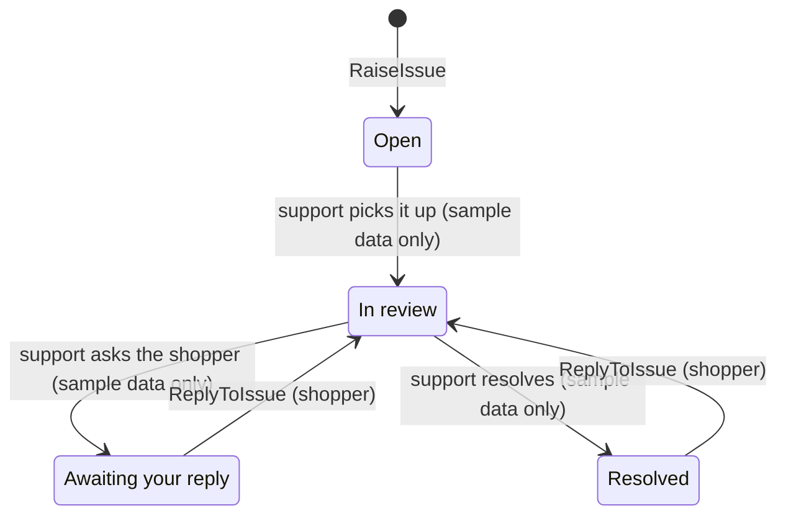

# SupportIssue (aggregate)

## Definition

A problem a shopper raised about one item of one of their orders, together with the conversation about
it and where it stands. The status says whose move it is: the support team's or the shopper's.

## Structure

### SupportIssue

Root entity. Identity: `id` in the form `CS-NNNNN`.

| Attribute | Type | Required | Meaning | Code |
| --- | --- | --- | --- | --- |
| id | text | yes | Issue reference | `id` |
| orderId | `Ordering.OrderReference` | yes | The order the item came from | `orderId` |
| productId | item id | yes | The item the issue is about | `productId` |
| topic | `CustomerService.SupportTopic` | yes | What went wrong | `topic` |
| status | Open, In review, Awaiting your reply, Resolved | yes | See lifecycle | `status` |
| createdAt | timestamp | yes | When raised | `createdAt` |
| updatedAt | timestamp | yes | Time of the latest message | `updatedAt` |
| read | boolean | yes | False while there is an unread support reply | `read` |
| messages | list of `CustomerService.SupportMessage` | yes, ≥ 1 | The thread, oldest first | `messages` |

### SupportMessage

Entity. Identity: `id` (`<issue id>-m<n>`).

| Attribute | Type | Required | Meaning | Code |
| --- | --- | --- | --- | --- |
| from | customer or support | yes | Who wrote it | `from` |
| author | text | yes | Display name (the shopper's first name, or "HexCommerce Support") | `author` |
| body | text | yes | The message | `body` |
| sentAt | timestamp | yes | When sent | `sentAt` |

## Invariants

- CS-BR-001 — Issues only about items actually ordered
- CS-BR-002 — An item and a topic are required
- CS-BR-006 — Issue statuses and how a shopper reply moves them
- CS-BR-007 — Unread replies

## Lifecycle



| From | To | Triggered by | Guard (rule) |
| --- | --- | --- | --- |
| — | Open | `CustomerService.RaiseIssue` | CS-BR-001, CS-BR-002 |
| Awaiting your reply, Resolved | In review | `CustomerService.ReplyToIssue` | CS-BR-006 |
| Open, In review | unchanged | `CustomerService.ReplyToIssue` | CS-BR-006 |
| any | any | support-agent reply (not built) | CS-BR-009 |

## Behaviour

| Commands handled | Events emitted |
| --- | --- |
| `CustomerService.RaiseIssue` | `CustomerService.IssueRaised` |
| `CustomerService.ReplyToIssue` | `CustomerService.ShopperReplied` |
| `CustomerService.MarkIssueRead` | `CustomerService.IssueRead` |

## References to other aggregates

| Reference | Points to | Cardinality | Notes |
| --- | --- | --- | --- |
| orderId | `Ordering.Order` | many to 1 | |
| productId | `Ordering.OrderItem` (by product id within the order) | many to 1 | |

## Example

From `src/data/support.ts` (`seedSupportIssues`), trimmed:

```json
{
  "id": "CS-40318",
  "orderId": "204-7712880-3341902",
  "productId": "p-2001",
  "topic": "Item arrived damaged or defective",
  "status": "Awaiting your reply",
  "createdAt": "2025-02-25T09:12:00.000Z",
  "updatedAt": "2025-02-26T14:40:00.000Z",
  "read": false,
  "messages": [
    { "id": "CS-40318-m1", "from": "customer", "author": "Alex", "body": "This arrived with a cracked casing…" },
    { "id": "CS-40318-m2", "from": "support", "author": "HexCommerce Support", "body": "Sorry about that, Alex…" }
  ]
}
```

## Implementation

- **Types:** `src/lib/types.ts` (`SupportIssue`, `SupportMessage`, `SupportIssueStatus`)
- **State changes:** `src/components/support/CustomerServiceView.tsx` (`reducer`, `handleCreate`, `handleReply`, `toggleExpand`)
- **Persistence:** `localStorage` key `hexcommerce.support.v1`
