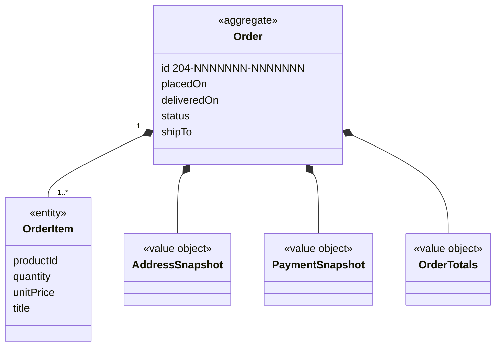

# Ordering context

## Purpose

Ordering turns a basket into a confirmed **order**: a permanent record of what was bought, at what
prices, delivered where, paid with which card, and expected when. It keeps the shopper's order history
and tells other contexts what has been bought: sellers through their seller orders, Reviews through
verified purchases, and CustomerService through the items a shopper can ask about.

## Strategic classification

| Aspect | Value |
| --- | --- |
| Subdomain | `SD-PURCHASING` (core) |
| Business objectives served | BO-02, BO-04 |
| Domain role | Execution (checkout) and record-keeping (order history) |
| Owner | Product Owner; totals and payment: Finance |

## Responsibilities

**This context is responsible for:**
- checkout: choosing the delivery address, card and delivery speed, and placing the order;
- the order record and its snapshot of prices, titles, address, card and totals;
- the expected delivery date and the tracking stages;
- handing marketplace lines to SellerCentral when an order is placed;
- order history, order detail and the invoice;
- answering "has this shopper bought this product?".

**This context is deliberately not responsible for:**
- the basket, its limits and its totals. Those are owned by [Shopping](../shopping/README.md); checkout
  copies them.
- the address book and saved cards. Those are owned by [Account](../account/README.md); the order
  copies the chosen address and the card's brand and last four digits.
- the seller's fulfilment. That is owned by [SellerCentral](../seller-central/README.md).
- payment, fulfilment, cancellation and returns. These are not built (SD-PAYMENTS, SD-FULFILMENT).

## Model overview

| Aggregate | In one line | File |
| --- | --- | --- |
| `Ordering.Order` | A confirmed purchase and everything captured when it was placed | [aggregates/order.md](aggregates/order.md) |

## Contents

| File | What it holds |
| --- | --- |
| [ubiquitous-language.md](ubiquitous-language.md) | Terms of this context and their code identifiers |
| [aggregates/](aggregates/) | `Order` |
| [value-objects.md](value-objects.md) | `OrderReference`, `OrderTotals`, `DeliverySpeed`, `AddressSnapshot`, `PaymentSnapshot` |
| [business-rules.md](business-rules.md) | Placing, snapshot, delivery dates, statuses, history, purchase check |
| [use-cases.md](use-cases.md) | Actor goals this context serves, step by step |
| [commands.md](commands.md) | `PlaceOrder` |
| [domain-events.md](domain-events.md) | `OrderPlaced` and who reacts to it |
| [read-models.md](read-models.md) | Order history, detail, invoice, tracking, purchase check |

## Relationships

| REL | Direction | Other context | Pattern | What crosses |
| --- | --- | --- | --- | --- |
| REL-01 | downstream of | [StoreConfig](../store-config/README.md) | SK + CF | `StoreConfig.Money`, `StoreConfig.StoreClock`, settings |
| REL-07 | downstream of | [Shopping](../shopping/README.md) | C/S | `Shopping.DetailedBasket`, `Shopping.BasketTotals`, `Shopping.StockProblems` in; `Shopping.ClearBasket` out |
| REL-08 | downstream of | [Account](../account/README.md) | CF | `Account.DeliverTo`, `Account.SavedCards` |
| REL-09 | downstream of | [SellerCentral](../seller-central/README.md) | OHS → CF | `SellerCentral.RecordSale` with `SellerCentral.SaleLine` |
| REL-10 | upstream of | [Reviews](../reviews/README.md) | OHS → CF | `Ordering.PurchaseCheck` |
| REL-11 | upstream of | [CustomerService](../customer-service/README.md) | ACL (in CustomerService) | `Ordering.OrderHistory` → `CustomerService.OrderedItem` |
| REL-14 | downstream of | [Catalog](../catalog/README.md) | CF | `Catalog.ProductLookup` for sample orders without captured prices |

## Actors

| Actor | What they do here |
| --- | --- |
| ACT-SHOPPER | `Ordering.PlaceOrder`; reads history, detail, invoice and tracking |
| ACT-PSP, ACT-CARRIER | Target state: payment authorisation, delivery progress |

## Code map

| Concept | Code location | Notes |
| --- | --- | --- |
| `Ordering.Order` | `src/lib/types.ts` (`Order`, `OrderItem`, `OrderTotals`, `OrderStatus`) | |
| `Ordering.PlaceOrder` | `src/components/checkout/CheckoutView.tsx` (`placeOrder`) | The application service lives in a UI component |
| Order storage | `src/context/AccountProvider.tsx` (`placedOrders`, `placeOrder`, `orders`, `getOrder`) | Stored by the Account store |
| Sample history | `src/data/account.ts` (`orders`, `getOrderTotals`, `hasPurchased`) | |
| History, detail, invoice | `src/components/orders/OrdersView.tsx`, `src/components/orders/OrderDetailView.tsx` | |

### Implementation notes

- **Two contexts share one store.** Orders are stored in `AccountProvider` next to the address book,
  because both belonged to "the account" when the app was written. Logically, Ordering owns
  `Ordering.Order`. A new feature that changes orders should go through Ordering's commands, not
  through the address-book code.
- **Checkout orchestrates three contexts in one function.** `placeOrder` calls SellerCentral's
  `recordSale`, then stores the order, then calls Shopping's `clearCart`. There is no transaction: if
  `recordSale` fails (storage full), the order is still placed (ORD-BR-010).
- The UI calls next-day delivery `express` in code.

## Known gaps

| Gap | Rules | Impact |
| --- | --- | --- |
| No payment is taken | ORD-BR-012 | Orders are records only |
| Placed orders never move beyond Processing; there is no fulfilment or per-line status | ORD-BR-013 | Tracking shows stage 1 forever for new orders |
| No cancellation or returns | ORD-BR-014, ORD-BR-015 | "Return or replace items" opens a support issue instead |
| No next-day cut-off time | ORD-BR-003 | Next-day is always +1 day |
| Expired cards are accepted at checkout | ORD-BR-016 | |
| Seller orders may be lost if saving them fails | ORD-BR-010 | Seller never sees the sale |

## Open questions

| ID | Question | Raised | Owner |
| --- | --- | --- | --- |
| ORD-Q-01 | Should the order record which seller order each marketplace line became, so support and returns can trace it? | 2026-10-27 | Marketplace operations lead |
