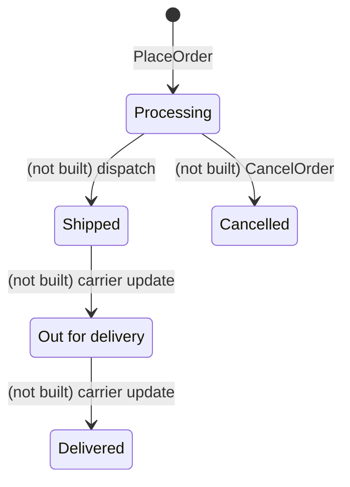

# Order (aggregate)

## Definition

A confirmed purchase. When it is placed, the order captures everything that could change later: item
titles and unit prices, the delivery address, the card's brand and last four digits, and the totals.
From then on it does not depend on the catalogue, the seller's listing or the address book. Its status
says how far delivery has progressed.

## Structure

### Order

Root entity. Identity: `id`, an `Ordering.OrderReference`.

| Attribute | Type | Required | Meaning | Code |
| --- | --- | --- | --- | --- |
| id | `Ordering.OrderReference` | yes | Order reference | `id` |
| placedOn | date | yes | Order date (store clock) | `placedOn` |
| deliveredOn | date | yes for placed orders | Expected, or actual, delivery date | `deliveredOn` |
| status | Processing, Shipped, Out for delivery, Delivered, Cancelled | yes | See lifecycle | `status` |
| shipTo | text | yes | Recipient name | `shipTo` |
| items | list of `Ordering.OrderItem` | yes, ≥ 1 | What was bought | `items` |
| address | `Ordering.AddressSnapshot` | yes for placed orders | Delivery address as it was | `address` |
| payment | `Ordering.PaymentSnapshot` | yes for placed orders | Card brand and last four | `payment` |
| totals | `Ordering.OrderTotals` | yes for placed orders | What was charged | `totals` |

Sample-history orders omit `address`, `payment`, `totals` and the item prices (ORD-BR-008).

### OrderItem

Entity inside the order. Identity: the item id within the order.

| Attribute | Type | Required | Meaning | Code |
| --- | --- | --- | --- | --- |
| productId | `Catalog.Product` or `SellerCentral.SellerListing` id | yes | What was bought | `productId` |
| quantity | integer ≥ 1 | yes | Units bought | `quantity` |
| unitPrice | `StoreConfig.Money` | yes for placed orders | Price paid per unit, including any deal | `unitPrice` |
| title | text | yes for placed orders | Title at the time of purchase | `title` |

## Invariants

- ORD-BR-001 — New orders start in Processing
- ORD-BR-005 — An order keeps what it was placed with
- ORD-BR-006 — No order while the basket has stock problems
- ORD-BR-007 — Order statuses

## Lifecycle



| From | To | Triggered by | Guard (rule) |
| --- | --- | --- | --- |
| — | Processing | `Ordering.PlaceOrder` | ORD-BR-001, ORD-BR-006 |
| Processing → … → Delivered | next stage | not built; only sample orders hold later statuses | ORD-BR-013 |
| Processing | Cancelled | not built | ORD-BR-014 |

## Behaviour

| Commands handled | Events emitted |
| --- | --- |
| `Ordering.PlaceOrder` | `Ordering.OrderPlaced` |

## References to other aggregates

| Reference | Points to | Cardinality | Notes |
| --- | --- | --- | --- |
| items[].productId | `Catalog.Product` / `SellerCentral.SellerListing` | many to 1 | Only for linking and sample pricing; the snapshot is authoritative |
| (marketplace lines) | `SellerCentral.SellerOrder` | 1 to 0..many | Not stored (ORD-Q-01) |

## Example

An order as `placeOrder` builds it from the sample account (the reference number is random):

```json
{
  "id": "204-5531872-9046615",
  "placedOn": "2025-03-10",
  "deliveredOn": "2025-03-11",
  "status": "Processing",
  "shipTo": "Alex Morgan",
  "items": [
    { "productId": "p-1008", "quantity": 1, "unitPrice": 79.99, "title": "EchoWave Portable Bluetooth Speaker, Waterproof" },
    { "productId": "SL-4820", "quantity": 1, "unitPrice": 30.4, "title": "Northgate Cast Iron Skillet, 26 cm, Pre-Seasoned" }
  ],
  "address": {
    "id": "addr-1", "label": "Home", "name": "Alex Morgan",
    "line1": "42 Northgate Street", "line2": "Flat 3B", "city": "Manchester",
    "state": "Greater Manchester", "postalCode": "M4 1HN", "country": "United Kingdom", "isDefault": true
  },
  "payment": { "brand": "Visa", "last4": "4242" },
  "totals": { "subtotal": 110.39, "shipping": 0, "tax": 9.66, "total": 120.05 }
}
```

Totals: subtotal 79.99 + 30.40 = 110.39; free delivery (≥ 35); tax 110.39 × 0.0875 = 9.659 → 9.66;
total 120.05. The skillet's unit price is its deal price (SEL-BR-015).

## Implementation

- **Type:** `src/lib/types.ts` (`Order`, `OrderItem`, `OrderTotals`, `OrderStatus`)
- **Created by:** `src/components/checkout/CheckoutView.tsx` (`placeOrder`)
- **Stored by:** `src/context/AccountProvider.tsx` (reducer case `placeOrder`, `placedOrders`)
- **Persistence:** `localStorage` key `hexcommerce.account.v1`. The sample history in
  `src/data/account.ts` is appended on read and never stored.
