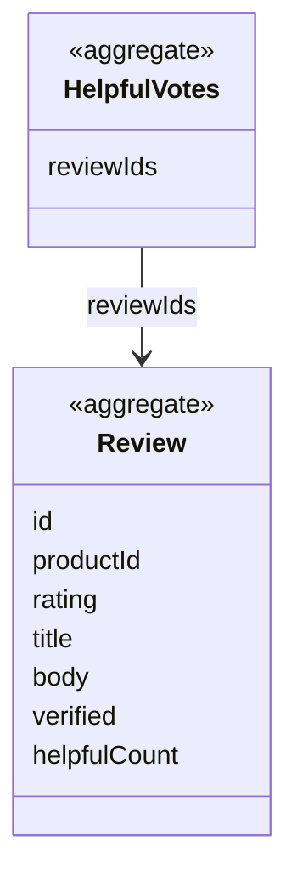

# Reviews context

## Purpose

Reviews lets shoppers tell each other what a product is like, and builds trust by marking reviews from
people who actually bought it. Shoppers can vote reviews helpful. A product's average rating takes in the
shopper's own reviews.

## Strategic classification

| Aspect | Value |
| --- | --- |
| Subdomain | `SD-TRUST` (supporting) |
| Business objectives served | BO-07 |
| Domain role | Execution (writing and voting) and analysis (rating summary) |
| Owner | Customer service lead (moderation in the target state) |

## Responsibilities

**This context is responsible for:**
- customer reviews: rating, headline, text, author, date, verified-purchase mark;
- helpful votes;
- the rating summary shown with a product's reviews.

**This context is deliberately not responsible for:**
- deciding whether the shopper bought the product. That is owned by [Ordering](../ordering/README.md)
  (`Ordering.PurchaseCheck`).
- the product's baseline rating and rating count. Those come from [Catalog](../catalog/README.md).
- moderation and reports. These are not built (BRD P31).

## Model overview

| Aggregate | In one line | File |
| --- | --- | --- |
| `Reviews.Review` | One shopper's opinion of one product | [aggregates/review.md](aggregates/review.md) |
| `Reviews.HelpfulVotes` | The reviews this shopper found helpful | [aggregates/helpful-votes.md](aggregates/helpful-votes.md) |

## Contents

| File | What it holds |
| --- | --- |
| [ubiquitous-language.md](ubiquitous-language.md) | Terms of this context and their code identifiers |
| [aggregates/](aggregates/) | `Review`, `HelpfulVotes` |
| [value-objects.md](value-objects.md) | `StarRating` |
| [business-rules.md](business-rules.md) | Validation, verified purchase, votes, rating summary |
| [use-cases.md](use-cases.md) | Actor goals this context serves, step by step |
| [commands.md](commands.md) | Write, delete, vote, withdraw vote |
| [domain-events.md](domain-events.md) | Review and vote events |
| [read-models.md](read-models.md) | `ProductReviews`, `RatingSummary` |

## Relationships

| REL | Direction | Other context | Pattern | What crosses |
| --- | --- | --- | --- | --- |
| REL-10 | downstream of | [Ordering](../ordering/README.md) | OHS → CF | `Ordering.PurchaseCheck` |
| REL-12 | downstream of | [Catalog](../catalog/README.md) | CF | Product id, baseline rating and rating count |
| REL-13 | downstream of | [Account](../account/README.md) | CF | `Account.CurrentShopper` (author name) |

## Actors

| Actor | What they do here |
| --- | --- |
| ACT-SHOPPER | Writes and deletes their reviews; votes |
| ACT-SUPPORT-TEAM | Target state: moderates reports |

## Code map

| Concept | Code location | Notes |
| --- | --- | --- |
| `Reviews.Review` | `src/lib/types.ts` (`Review`), `src/data/reviews.ts` (`reviews`, `createCustomerReview`) | |
| State changes | `src/components/product/ReviewsSection.tsx` (reducer, `handleSubmit`, `toggleHelpful`) | The store lives in a UI component |
| `Reviews.HelpfulVotes` | `src/data/reviews.ts` (`loadHelpfulVotes`, `saveHelpfulVotes`) | |
| Sample and generic reviews | `src/data/reviews.ts` (`reviews`, `GENERIC_REVIEWS`, `getReviewsForProduct`) | |

### Implementation notes

- The shopper's own reviews are stored by product under `localStorage` key `hexcommerce.reviews.v1`.
  Votes are stored under `hexcommerce.reviewVotes.v1`.
- Reviews appear only on catalogue product pages. Seller listings have no reviews (SEL-BR-008).

## Known gaps

| Gap | Rules | Impact |
| --- | --- | --- |
| The rating histogram is synthesised from the average | REV-BR-007 | The distribution shown is not the real one |
| No moderation, reports or editing | REV-BR-011 | Abusive content cannot be removed |
| The helpful count of other reviews does not include other shoppers' votes | REV-BR-005 | Only one browser's votes exist |

## Open questions

| ID | Question | Raised | Owner |
| --- | --- | --- | --- |
| REV-Q-01 | Should a shopper be limited to one review per product (and edit it), rather than writing several? | 2026-10-27 | Product Owner |
