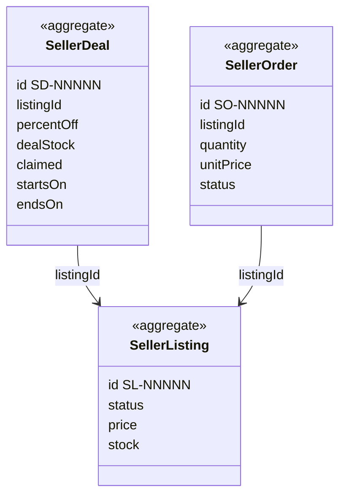

# SellerCentral context

## Purpose

SellerCentral is where an approved seller runs their business on the marketplace: they list products,
run time-limited deals on them, and fulfil the orders shoppers place for them. It also publishes the
seller's sellable listings to the storefront as products, priced with any running deal. That feed is
what turns HexCommerce from a shop into a marketplace.

## Strategic classification

| Aspect | Value |
| --- | --- |
| Subdomain | `SD-MARKETPLACE` (core) |
| Business objectives served | BO-03, BO-05, BO-06 |
| Domain role | Execution (seller work) and gateway (publishes the storefront feed) |
| Owner | Marketplace operations lead |

## Responsibilities

**This context is responsible for:**
- seller listings: content, condition, price, stock, images and their status;
- seller deals: discount, unit allowance, date window, status, and which deal prices a listing;
- seller orders: recording a sale, reducing stock, counting deal claims, and dispatch status;
- the seller's headline figures (listings by status, units sold, revenue, estimated payout);
- the storefront feed: listings and deals in the `Catalog.Product` published language.

**This context is deliberately not responsible for:**
- deciding who may sell. That is owned by [SellerOnboarding](../seller-onboarding/README.md); this
  context only reads the outcome.
- the shopper's order, payment and delivery address. Those are owned by
  [Ordering](../ordering/README.md); a seller sees only the buyer's name and city.
- how many units a shopper may put in the basket. That is owned by [Shopping](../shopping/README.md),
  which reads the units offered here.
- payouts, referral-fee schedules and payout accounts (BRD P27/P28). These are not built; only an
  estimate exists.

## Model overview

| Aggregate | In one line | File |
| --- | --- | --- |
| `SellerCentral.SellerListing` | A product a seller offers, and whether shoppers can buy it | [aggregates/seller-listing.md](aggregates/seller-listing.md) |
| `SellerCentral.SellerDeal` | A time-limited percentage discount with a unit allowance on one listing | [aggregates/seller-deal.md](aggregates/seller-deal.md) |
| `SellerCentral.SellerOrder` | The seller's record of one sale of one listing, and its dispatch | [aggregates/seller-order.md](aggregates/seller-order.md) |

## Contents

| File | What it holds |
| --- | --- |
| [ubiquitous-language.md](ubiquitous-language.md) | Terms of this context and their code identifiers |
| [aggregates/](aggregates/) | `SellerListing`, `SellerDeal`, `SellerOrder` |
| [value-objects.md](value-objects.md) | `ListingCondition`, `ListingImages`, `DealWindow`, `SaleLine`, `SellerReference` |
| [business-rules.md](business-rules.md) | Listing validation and status, deal rules and pricing, orders, earnings |
| [use-cases.md](use-cases.md) | Actor goals this context serves, step by step |
| [commands.md](commands.md) | Listing, deal and order commands, and `RecordSale` |
| [domain-events.md](domain-events.md) | Events, and the policies that keep stock, deals and the storefront consistent |
| [read-models.md](read-models.md) | Storefront feed, running deal, paused reason, seller summary |

## Relationships

| REL | Direction | Other context | Pattern | What crosses |
| --- | --- | --- | --- | --- |
| REL-01 | downstream of | [StoreConfig](../store-config/README.md) | SK + CF | `StoreConfig.Money`, `StoreConfig.StoreClock` |
| REL-03 | upstream of | [Shopping](../shopping/README.md) | OHS → CF | `SellerCentral.StorefrontProduct` (per listing) |
| REL-04 | upstream of | [Catalog](../catalog/README.md) | OHS → CF | `SellerCentral.StorefrontProducts`, `SellerCentral.StorefrontDeals` |
| REL-05 | downstream of | [Catalog](../catalog/README.md) | PL → CF | Produces `Catalog.Product`; uses the department taxonomy |
| REL-06 | downstream of | [SellerOnboarding](../seller-onboarding/README.md) | C/S | `SellerOnboarding.SellerProfile` (business name) while approved |
| REL-09 | upstream of | [Ordering](../ordering/README.md) | OHS → CF | `SellerCentral.RecordSale` with `SellerCentral.SaleLine` |

## Actors

| Actor | What they do here |
| --- | --- |
| ACT-SELLER | Creates and maintains listings and deals; dispatches and delivers seller orders |
| ACT-SHOPPER | Indirectly: buying a listing records a sale (through Ordering) |
| ACT-FINANCE | Target state: fee schedule and payouts |

## Code map

| Concept | Code location | Notes |
| --- | --- | --- |
| `SellerCentral.SellerListing` | `src/lib/types.ts` (`SellerListing`), `src/context/SellerProvider.tsx` (reducer `create`, `update`, `delete`, `setListingStatus`) | |
| `SellerCentral.SellerDeal` | `src/lib/types.ts` (`SellerDeal`), `src/data/seller.ts` (`resolveDealStatus`, `isDealRunning`, `findOverlappingDeal`) | |
| `SellerCentral.SellerOrder` | `src/lib/types.ts` (`SellerOrder`), `src/context/SellerProvider.tsx` (`recordSale`, `setOrderStatus`) | |
| Storefront feed | `src/data/seller.ts` (`toStorefrontProduct`), `src/context/SellerProvider.tsx` (`storefrontProducts`, `getStorefrontProduct`, `storefrontDeals`) | Translator into `Catalog.Product` |
| Listing validation | `src/components/seller/ListingEditor.tsx` (`validateStep`), `src/components/seller/ImageUploadField.tsx` | Validation lives in the UI |
| Deal validation | `src/components/seller/DealEditor.tsx` (`validate`) | Validation lives in the UI |
| Seller summary | `src/data/seller.ts` (`summariseSeller`, `SELLER_REFERRAL_FEE`) | |
| Access gate | `src/components/seller/SellerGate.tsx` | Reads SellerOnboarding |

### Implementation notes

- All three aggregates live in one client store (`SellerProvider`), which wraps the whole app because
  the storefront reads it. Each change is written to `localStorage` *before* it is applied, and is
  refused when it would not fit (SEL-BR-029).
- Input validation (SEL-BR-001, SEL-BR-010 to SEL-BR-014) runs in the editor components, not the
  store. Any other caller of `createListing` or `createDeal` bypasses it.
- `recordSale` is one atomic reducer step: it creates seller orders, reduces listing stock and counts
  deal claims together.

## Known gaps

| Gap | Rules | Impact |
| --- | --- | --- |
| A seller cannot cancel a `New` order | SEL-BR-024 | Unfulfillable orders stay `New` |
| Payout is a flat 12% estimate: no fee schedule, returns, payout runs or payout account | SEL-BR-026 | Earnings shown are indicative only |
| Fractional stock and any image type are accepted | SEL-BR-001, SEL-BR-006 | Data quality |
| A seller can buy their own listing | SEL-BR-028 | Fake sales and inflated deal claims |
| Cancelling a shopper order does not restore stock or deal claims | — | No cancellation exists yet (BR-ORD-011) |

## Open questions

| ID | Question | Raised | Owner |
| --- | --- | --- | --- |
| SEL-Q-01 | Should listing and deal validation move into the store (aggregate), so every caller is checked? | 2026-10-27 | Engineering lead |
| SEL-Q-02 | A discount entered as 4.6 is refused even though it would round to 5. Validate before or after rounding? | 2026-10-27 | Marketplace operations lead |
