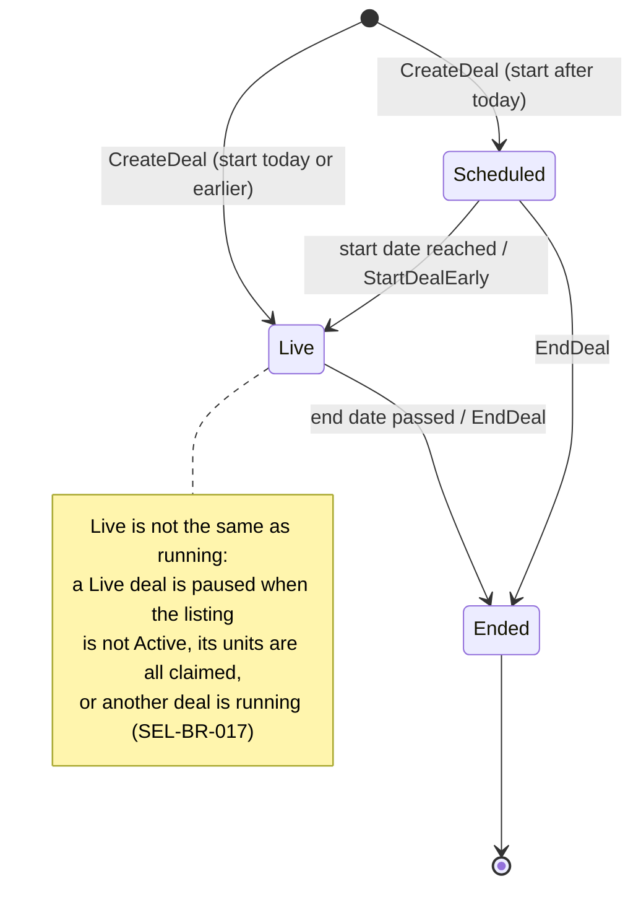

# SellerDeal (aggregate)

## Definition

A time-limited percentage discount that a seller runs on one of their own listings, with a fixed number
of units on offer at the deal price. Its status follows its dates; it is never trusted as stored. While
a deal is **running**, shoppers pay the deal price for up to the remaining deal units.

## Structure

### SellerDeal

Root entity. Identity: `id` in the form `SD-NNNNN`.

| Attribute | Type | Required | Meaning | Code |
| --- | --- | --- | --- | --- |
| id | `SellerCentral.SellerReference` | yes | Deal reference | `id` |
| listingId | `SellerCentral.SellerListing` id | yes | The discounted listing | `listingId` |
| percentOff | whole number 5–70 | yes | Discount off the listing's normal price | `percentOff` |
| dealUnits | whole number ≥ 1 | yes | Units committed to the deal | `dealStock` |
| claimed | whole number 0–dealUnits | yes | Units bought at the deal price so far | `claimed` |
| window | `SellerCentral.DealWindow` | yes | Start and end dates | `startsOn`, `endsOn` |
| status | Scheduled, Live, Ended | yes | Derived from the dates (SEL-BR-016). Only Ended is stored meaningfully. | `status` |
| createdAt, updatedAt | timestamp | yes | Audit times | `createdAt`, `updatedAt` |

## Invariants

- SEL-BR-010 — Discount between 5% and 70%
- SEL-BR-011 — Deal units within listing stock
- SEL-BR-012 — Deal units never below units claimed
- SEL-BR-013 — Valid deal window
- SEL-BR-014 — No overlapping deals on a listing
- SEL-BR-016 — Deal status follows its dates
- SEL-BR-020 — Claims are counted and capped
- SEL-BR-023 — An ended deal stays ended

## Lifecycle



| From | To | Triggered by | Guard (rule) |
| --- | --- | --- | --- |
| — | Scheduled / Live | `SellerCentral.CreateDeal` | SEL-BR-010 to SEL-BR-014, SEL-BR-022 |
| Scheduled | Live | start date reached (derived) | SEL-BR-016 |
| Scheduled | Live | `SellerCentral.StartDealEarly` | SEL-BR-021 |
| Scheduled, Live | Ended | `SellerCentral.EndDeal` | SEL-BR-023 |
| Live | Ended | end date passed (derived) | SEL-BR-016 |
| any | removed | `SellerCentral.DeleteDeal`, or its listing is deleted | SEL-BR-007 |

## Behaviour

| Commands handled | Events emitted |
| --- | --- |
| `SellerCentral.CreateDeal` | `SellerCentral.DealCreated` |
| `SellerCentral.UpdateDeal` | `SellerCentral.DealUpdated` |
| `SellerCentral.StartDealEarly` | `SellerCentral.DealStarted` |
| `SellerCentral.EndDeal` | `SellerCentral.DealEnded` |
| `SellerCentral.DeleteDeal` | `SellerCentral.DealDeleted` |
| `SellerCentral.RecordSale` (claims part) | `SellerCentral.SaleRecorded` |

## References to other aggregates

| Reference | Points to | Cardinality | Notes |
| --- | --- | --- | --- |
| listingId | `SellerCentral.SellerListing` | many to 1 | At most one deal is running per listing (SEL-BR-018) |

## Example

From `src/data/seller.ts` (`seedDeals`), with dates resolved against the store clock (10 March 2025):

```json
{
  "id": "SD-31908",
  "listingId": "SL-4820",
  "percentOff": 20,
  "dealStock": 40,
  "claimed": 18,
  "status": "Live",
  "startsOn": "2025-03-08",
  "endsOn": "2025-03-13"
}
```

Derived: deal price 38.00 × 0.80 = 30.40 (SEL-BR-015). The storefront offers min(64 in stock, 22 units
left) = 22 units at 30.40, with "was" price 38.00 and badge "20% off deal" (SEL-BR-019).

## Implementation

- **Type:** `src/lib/types.ts` (`SellerDeal`, `SellerDealStatus`)
- **Domain functions:** `src/data/seller.ts` (`sellerDealPrice`, `resolveDealStatus`, `dealUnitsLeft`,
  `isDealRunning`, `runningDealFor`, `findOverlappingDeal`, `dealPausedReason`)
- **State changes:** `src/context/SellerProvider.tsx` (reducer cases `createDeal`, `updateDeal`,
  `deleteDeal`, `setDealStatus`, `recordSale`; `storedDealStatus`)
- **Validation:** `src/components/seller/DealEditor.tsx` (`validate`)
- **Persistence:** `localStorage` key `hexcommerce.seller.v1`
