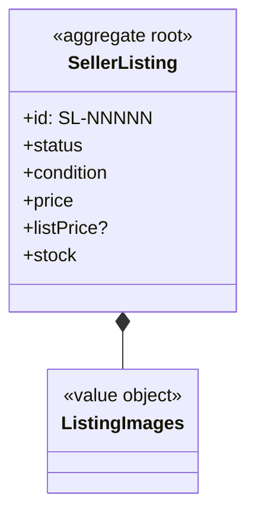
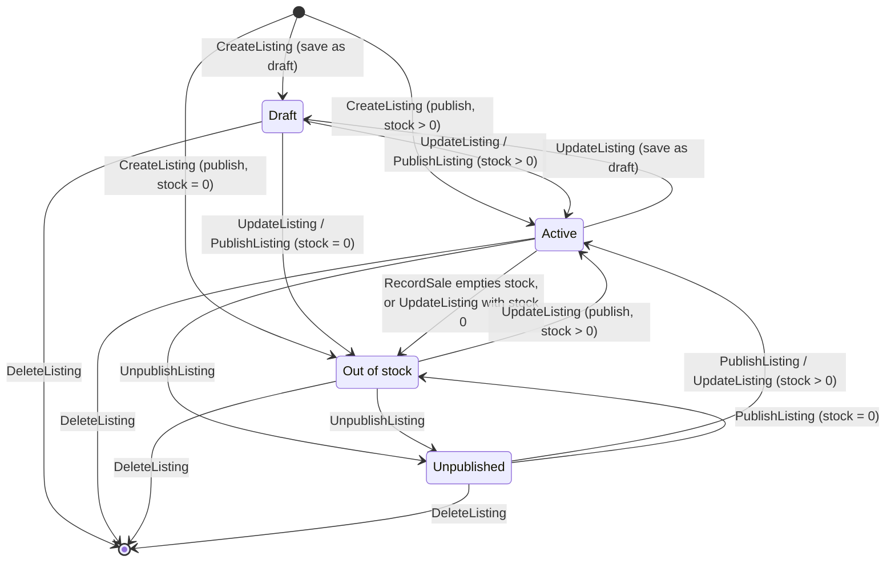

# SellerListing (aggregate)

## Definition

A product a seller offers on the marketplace. It holds the seller's own content (title, brand,
department, condition, description, images), price and stock, and a status that decides whether shoppers
can buy it. The listing is the seller's model. Shoppers see it through `SellerCentral.StorefrontProduct`.

## Structure



### SellerListing

Root entity. Identity: `id` in the form `SL-NNNNN` (`SellerCentral.SellerReference`).

| Attribute | Type | Required | Meaning | Code |
| --- | --- | --- | --- | --- |
| id | `SellerCentral.SellerReference` | yes | Listing reference | `id` |
| title | text | yes | Product title | `title` |
| brand | text | yes | Brand or maker | `brand` |
| department | `Catalog.Department` slug | yes | Department, from the catalogue taxonomy | `category` |
| subcategory | `Catalog.Subcategory` slug | no | Subcategory of that department | `subcategory` |
| condition | `SellerCentral.ListingCondition` | yes | New, Renewed, Used – like new, Used – good | `condition` |
| price | `StoreConfig.Money` | yes | Normal selling price, above 0 | `price` |
| wasPrice | `StoreConfig.Money` | no | Optional higher reference price | `listPrice` |
| stock | integer ≥ 0 | yes | Units on hand | `stock` |
| status | Active, Draft, Out of stock, Unpublished | yes | See lifecycle | `status` |
| summary | text ≤ 160 | yes | One line for cards | `summary` |
| description | text | yes | Full description | `description` |
| features | list of text | no | "About this item" bullets | `features` |
| images | `SellerCentral.ListingImages` | no | Up to six; the first is the cover | `images` |
| createdAt, updatedAt | timestamp | yes | Audit times | `createdAt`, `updatedAt` |

## Invariants

- SEL-BR-001 — Required listing details
- SEL-BR-002 — Status after saving
- SEL-BR-003 — Only Active listings are sold
- SEL-BR-005 — A sale reduces stock
- SEL-BR-006 — Listing images
- SEL-BR-007 — Deleting a listing deletes its deals

## Lifecycle



| From | To | Triggered by | Guard (rule) |
| --- | --- | --- | --- |
| — | Draft / Active / Out of stock | `SellerCentral.CreateListing` | SEL-BR-001, SEL-BR-002 |
| any | Draft | `SellerCentral.UpdateListing` saved as draft | SEL-BR-002 |
| any | Active / Out of stock | `SellerCentral.UpdateListing` published | SEL-BR-002 |
| Active, Out of stock | Unpublished | `SellerCentral.UnpublishListing` | — |
| Draft, Unpublished | Active (stock > 0) or Out of stock | `SellerCentral.PublishListing` | SEL-BR-002 |
| Active | Out of stock | `SellerCentral.RecordSale` empties stock | SEL-BR-005 |
| any | removed | `SellerCentral.DeleteListing` | SEL-BR-007 |

## Behaviour

| Commands handled | Events emitted |
| --- | --- |
| `SellerCentral.CreateListing` | `SellerCentral.ListingCreated` |
| `SellerCentral.UpdateListing` | `SellerCentral.ListingUpdated` |
| `SellerCentral.PublishListing`, `SellerCentral.UnpublishListing` | `SellerCentral.ListingStatusChanged` |
| `SellerCentral.DeleteListing` | `SellerCentral.ListingDeleted` |
| `SellerCentral.RecordSale` (stock part) | `SellerCentral.SaleRecorded` |

## References to other aggregates

| Reference | Points to | Cardinality | Notes |
| --- | --- | --- | --- |
| category, subcategory | `Catalog.Department`, `Catalog.Subcategory` | many to 1 | Taxonomy conformed to (REL-05) |
| (seller) | `SellerOnboarding.SellerApplication` | many to 1 | Implicit: the signed-in shopper's own approved application |

## Example

From `src/data/seller.ts` (`seedListings`), trimmed:

```json
{
  "id": "SL-4820",
  "title": "Northgate Cast Iron Skillet, 26 cm, Pre-Seasoned",
  "brand": "Northgate",
  "category": "home-kitchen",
  "subcategory": "cookware",
  "condition": "New",
  "price": 38.0,
  "listPrice": 49.0,
  "stock": 64,
  "status": "Active",
  "summary": "Oven-safe cast iron skillet with a smooth pre-seasoned cooking surface.",
  "createdAt": "2024-11-02T10:00:00.000Z",
  "updatedAt": "2025-02-14T09:30:00.000Z"
}
```

## Implementation

- **Type:** `src/lib/types.ts` (`SellerListing`, `ListingStatus`, `ListingCondition`)
- **State changes:** `src/context/SellerProvider.tsx` (reducer cases `create`, `update`, `delete`,
  `setListingStatus`, `recordSale`; `resolveStatus`)
- **Validation:** `src/components/seller/ListingEditor.tsx` (`validateStep`),
  `src/components/seller/ImageUploadField.tsx`
- **Persistence:** `localStorage` key `hexcommerce.seller.v1`, written before each change is applied
