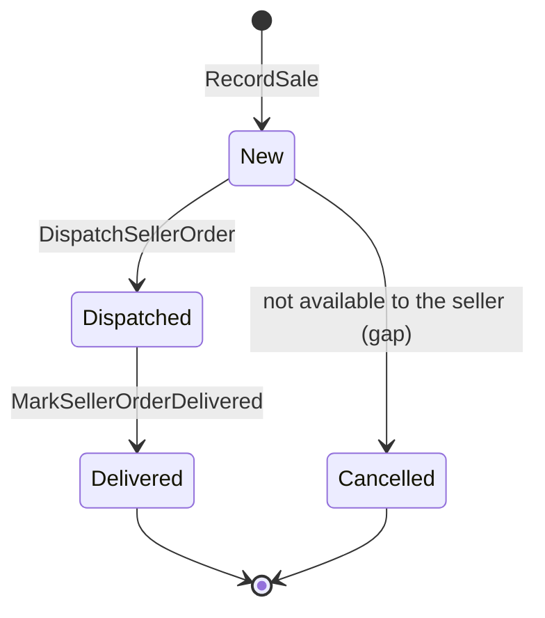

# SellerOrder (aggregate)

## Definition

The seller's record of one sale of one of their listings: who bought it (name and city only), how many,
at what unit price, and how far its dispatch has got. One shopper order with marketplace lines produces
one seller order per marketplace line. It is a different concept from `Ordering.Order`, which is the
shopper's record of the whole purchase.

## Structure

### SellerOrder

Root entity. Identity: `id` in the form `SO-NNNNN`.

| Attribute | Type | Required | Meaning | Code |
| --- | --- | --- | --- | --- |
| id | `SellerCentral.SellerReference` | yes | Seller order reference | `id` |
| listingId | `SellerCentral.SellerListing` id | yes | The listing bought | `listingId` |
| buyer | text | yes | Buyer's name only | `buyer` |
| city | text | yes | Buyer's city, for the dispatch label | `city` |
| quantity | integer ≥ 1 | yes | Units bought | `quantity` |
| unitPrice | `StoreConfig.Money` | yes | Price per unit paid, including any deal | `unitPrice` |
| placedOn | date | yes | Order date (store clock) | `placedOn` |
| status | New, Dispatched, Delivered, Cancelled | yes | Fulfilment state | `status` |

## Invariants

- SEL-BR-024 — Seller order transitions
- SEL-BR-025 — A seller order records the sale as it was

## Lifecycle



| From | To | Triggered by | Guard (rule) |
| --- | --- | --- | --- |
| — | New | `SellerCentral.RecordSale` | SEL-BR-025 |
| New | Dispatched | `SellerCentral.DispatchSellerOrder` | SEL-BR-024 |
| Dispatched | Delivered | `SellerCentral.MarkSellerOrderDelivered` | SEL-BR-024 |
| New | Cancelled | none as-built (sample data only) | SEL-BR-024 |

## Behaviour

| Commands handled | Events emitted |
| --- | --- |
| `SellerCentral.RecordSale` | `SellerCentral.SaleRecorded` |
| `SellerCentral.DispatchSellerOrder` | `SellerCentral.SellerOrderDispatched` |
| `SellerCentral.MarkSellerOrderDelivered` | `SellerCentral.SellerOrderDelivered` |

## References to other aggregates

| Reference | Points to | Cardinality | Notes |
| --- | --- | --- | --- |
| listingId | `SellerCentral.SellerListing` | many to 1 | |
| (shopper order) | `Ordering.Order` | many to 1 | Not stored. A seller order cannot be traced back to the shopper's order reference. |

## Example

```json
{
  "id": "SO-88213",
  "listingId": "SL-4820",
  "buyer": "Priya Shah",
  "city": "Leeds",
  "quantity": 1,
  "unitPrice": 38.0,
  "placedOn": "2025-03-06",
  "status": "New"
}
```

## Implementation

- **Type:** `src/lib/types.ts` (`SellerOrder`, `SellerOrderStatus`)
- **State changes:** `src/context/SellerProvider.tsx` (reducer cases `recordSale`, `setOrderStatus`)
- **Transitions offered:** `src/components/seller/SellerOrdersView.tsx`
- **Persistence:** `localStorage` key `hexcommerce.seller.v1`
