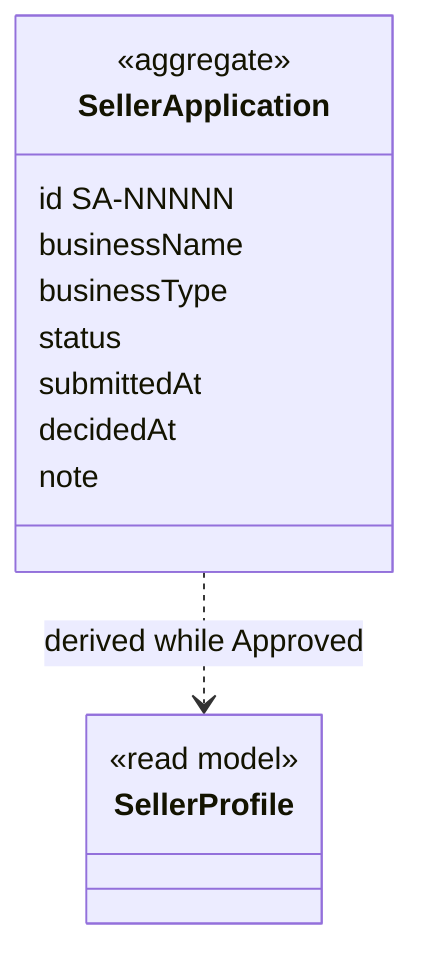

# SellerOnboarding context

## Purpose

SellerOnboarding decides who may sell on HexCommerce. A shopper applies on behalf of a business, an
administrator approves or rejects the application, and while it is approved it acts as the shopper's
seller account. Its details become the seller profile that shoppers buy from.

## Strategic classification

| Aspect | Value |
| --- | --- |
| Subdomain | `SD-SELLER-ONBOARDING` (supporting) |
| Business objectives served | BO-05, BO-10 |
| Domain role | Gateway: admits sellers to SellerCentral |
| Owner | Marketplace operations lead |

## Responsibilities

**This context is responsible for:**
- capturing and validating seller applications;
- the administrator's review queue and decisions (approve, reject with an optional reason, reconsider);
- whether the shopper is a seller, and their seller profile and business details.

**This context is deliberately not responsible for:**
- listings, deals and seller orders. Those are owned by [SellerCentral](../seller-central/README.md).
- payout accounts and their verification (BRD P27). These are not built; the profile shows a fixed
  masked account.
- staff identity and access control. These are not built: the admin queue is open to anyone.

## Model overview

| Aggregate | In one line | File |
| --- | --- | --- |
| `SellerOnboarding.SellerApplication` | A business's request to sell, and the decision on it | [aggregates/seller-application.md](aggregates/seller-application.md) |

## Contents

| File | What it holds |
| --- | --- |
| [ubiquitous-language.md](ubiquitous-language.md) | Terms of this context and their code identifiers |
| [aggregates/](aggregates/) | `SellerApplication` |
| [value-objects.md](value-objects.md) | `BusinessType`, `RegisteredAddress`, `ApplicationReference` |
| [business-rules.md](business-rules.md) | Validation, statuses, access, profile derivation |
| [commands.md](commands.md) | Submit, approve, reject, reconsider, update business details |
| [domain-events.md](domain-events.md) | Application lifecycle events |
| [read-models.md](read-models.md) | `SellerAccountStatus`, `SellerProfile`, `ReviewQueue` |

## Relationships

| REL | Direction | Other context | Pattern | What crosses |
| --- | --- | --- | --- | --- |
| REL-06 | upstream of | [SellerCentral](../seller-central/README.md) | C/S | `SellerOnboarding.SellerProfile`, `SellerOnboarding.SellerAccountStatus` |
| REL-13 | downstream of | [Account](../account/README.md) | CF | `Account.CurrentShopper` (name and email prefill the application) |

## Actors

| Actor | What they do here |
| --- | --- |
| ACT-PROSPECTIVE-SELLER | `SellerOnboarding.SubmitApplication` |
| ACT-ADMIN | `SellerOnboarding.ApproveApplication`, `SellerOnboarding.RejectApplication`, `SellerOnboarding.ReconsiderApplication` |
| ACT-SELLER | `SellerOnboarding.UpdateBusinessDetails` |

## Code map

| Concept | Code location | Notes |
| --- | --- | --- |
| `SellerOnboarding.SellerApplication` | `src/lib/types.ts` (`SellerApplication`), `src/context/SellerApplicationProvider.tsx` (reducer) | |
| Application form and validation | `src/components/seller/SellerApplicationForm.tsx` | |
| Admin review queue | `src/components/admin/SellerApplicationsAdminView.tsx`, route `/admin/sellers` | |
| `SellerOnboarding.SellerProfile` | `src/data/seller.ts` (`toSellerProfile`), `src/lib/types.ts` (`SellerProfile`) | The translator lives in the seller data module |
| Business details | `src/components/seller/BusinessDetailsView.tsx` | |
| Access gate | `src/components/seller/SellerGate.tsx` | |

### Implementation notes

- The store holds *every* application (the admin queue) plus a pointer, `myApplicationId`, to the
  signed-in shopper's own. In a real system the queue and "my application" would be served separately
  by role.
- On first visit the shopper owns the approved application `SA-09412` "Northgate Goods". The store also
  re-adds it to older saved data that lacks it.

## Known gaps

| Gap | Rules | Impact |
| --- | --- | --- |
| The admin queue is not restricted to administrators | SON-BR-011 | Anyone can approve their own application |
| The payout account is a fixed lookup; there is no verification | SON-BR-008 | "Verified" is shown without any check |
| The decider of an application is not recorded | — | No audit trail (BRD FR-ADM-013) |

## Open questions

| ID | Question | Raised | Owner |
| --- | --- | --- | --- |
| SON-Q-01 | When an approved seller's application is rejected or reconsidered, what happens to their live listings, open seller orders and running deals? As-built, they vanish from the storefront but stay stored. | 2026-10-27 | Marketplace operations lead |
