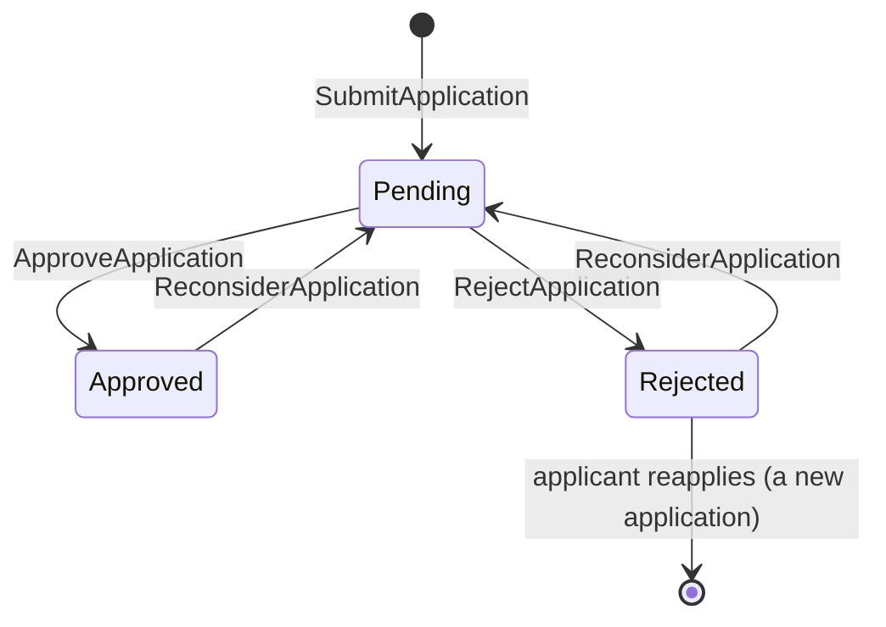

# SellerApplication (aggregate)

## Definition

A business's request to sell on HexCommerce, with the details it gave and the administrator's decision.
The applicant's own application, while `Approved`, *is* their seller account: it unlocks the seller tools
and provides the seller profile. There is no separate seller-account record.

## Structure

### SellerApplication

Root entity. Identity: `id` in the form `SA-NNNNN` (`SellerOnboarding.ApplicationReference`).

| Attribute | Type | Required | Meaning | Code |
| --- | --- | --- | --- | --- |
| id | `SellerOnboarding.ApplicationReference` | yes | Application reference | `id` |
| businessName | text | yes | Legal business name | `businessName` |
| businessType | `SellerOnboarding.BusinessType` | yes | Legal structure | `businessType` |
| contactName | text | yes | Primary contact | `contactName` |
| email | email | yes | Business email | `email` |
| phone | text | yes | Business phone | `phone` |
| website | URL | no | Existing online presence | `website` |
| description | text | yes | What the business will sell | `description` |
| yearsTrading | whole number ≥ 0 | yes | Years trading; not editable after approval | `yearsTrading` |
| registeredAddress | `SellerOnboarding.RegisteredAddress` | yes | Legal address | `line1`, `line2`, `city`, `state`, `postcode`, `country` |
| taxId | text | yes | Tax registration number | `taxId` |
| status | Pending, Approved, Rejected | yes | See lifecycle | `status` |
| submittedAt | timestamp | yes | When submitted | `submittedAt` |
| decidedAt | timestamp | when decided | When last decided | `decidedAt` |
| note | text | no | Administrator's note to the applicant | `note` |

## Invariants

- SON-BR-001 — Required application details
- SON-BR-002 — Business types
- SON-BR-003 — Application statuses and transitions
- SON-BR-005 — One live application per shopper
- SON-BR-009 — Business details after approval

## Lifecycle



| From | To | Triggered by | Guard (rule) |
| --- | --- | --- | --- |
| — | Pending | `SellerOnboarding.SubmitApplication` | SON-BR-001, SON-BR-002, SON-BR-005 |
| Pending | Approved | `SellerOnboarding.ApproveApplication` | SON-BR-003 |
| Pending | Rejected | `SellerOnboarding.RejectApplication` | SON-BR-003, SON-BR-007 |
| Approved, Rejected | Pending | `SellerOnboarding.ReconsiderApplication` (clears note and decision date) | SON-BR-003 |

## Behaviour

| Commands handled | Events emitted |
| --- | --- |
| `SellerOnboarding.SubmitApplication` | `SellerOnboarding.ApplicationSubmitted` |
| `SellerOnboarding.ApproveApplication` | `SellerOnboarding.ApplicationApproved` |
| `SellerOnboarding.RejectApplication` | `SellerOnboarding.ApplicationRejected` |
| `SellerOnboarding.ReconsiderApplication` | `SellerOnboarding.ApplicationReopened` |
| `SellerOnboarding.UpdateBusinessDetails` | `SellerOnboarding.BusinessDetailsUpdated` |

## References to other aggregates

| Reference | Points to | Cardinality | Notes |
| --- | --- | --- | --- |
| (applicant) | `Account.CustomerAccount` | many to 1 | Implicit: only `myApplicationId` marks the shopper's own |

## Example

The shopper's own seller account, from `src/data/sellerApplications.ts`:

```json
{
  "id": "SA-09412",
  "businessName": "Northgate Goods",
  "businessType": "Limited company",
  "contactName": "Alex Morgan",
  "email": "sales@northgategoods.example",
  "phone": "+44 161 555 0184",
  "website": "https://northgategoods.example",
  "yearsTrading": 1,
  "line1": "Northgate Works, 14 Bengal Street",
  "line2": "Unit 2",
  "city": "Manchester",
  "state": "Greater Manchester",
  "postcode": "M4 6LN",
  "country": "United Kingdom",
  "taxId": "GB412 7788 03",
  "status": "Approved",
  "submittedAt": "2022-08-24T10:02:00.000Z",
  "decidedAt": "2022-09-01T09:30:00.000Z"
}
```

## Implementation

- **Type:** `src/lib/types.ts` (`SellerApplication`, `SellerApplicationStatus`, `SellerBusinessType`)
- **State changes:** `src/context/SellerApplicationProvider.tsx` (reducer cases `submit`, `decide`,
  `reconsider`, `updateDetails`)
- **Validation:** `src/components/seller/SellerApplicationForm.tsx`, `src/components/seller/BusinessDetailsView.tsx`
- **Persistence:** `localStorage` key `hexcommerce.sellerApplications.v1`
