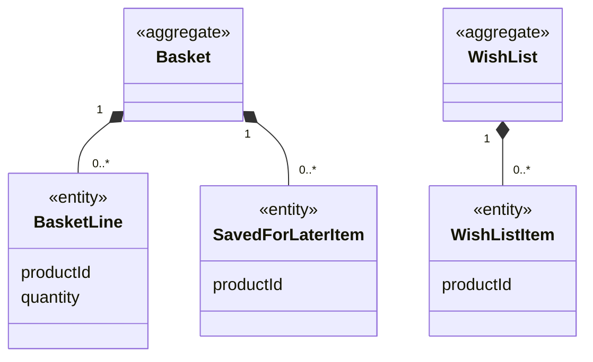

# Shopping context

## Purpose

Shopping holds what a shopper intends to buy: the **basket**, the **saved-for-later** list and the
**wish list**. It decides how many units of each item may be in the basket, given stock and the 10-unit
cap, and what the basket costs, including delivery, tax and savings. It is the bridge between finding a
product (Catalog) and buying it (Ordering).

## Strategic classification

| Aspect | Value |
| --- | --- |
| Subdomain | `SD-PURCHASING` (core) |
| Business objectives served | BO-02, BO-03 |
| Domain role | Execution: a draft of a future order |
| Owner | Product Owner |

## Responsibilities

**This context is responsible for:**
- basket lines and quantities, capped by units available and the 10-unit limit;
- moving items between the basket, the saved-for-later list and the wish list;
- basket totals: subtotal, delivery fee, tax, total, savings, and the amount left to reach free delivery;
- flagging lines that ask for more than is available, which blocks ordering.

**This context is deliberately not responsible for:**
- product prices and stock. Those are owned by [Catalog](../catalog/README.md) and, for seller
  listings, by [SellerCentral](../seller-central/README.md). The basket always reads them live.
- turning the basket into an order, the delivery address or the card. Those are owned by
  [Ordering](../ordering/README.md) and [Account](../account/README.md).
- the delivery fee, threshold and tax *values*. Those are owned by
  [StoreConfig](../store-config/README.md); Shopping applies them.

## Model overview

| Aggregate | In one line | File |
| --- | --- | --- |
| `Shopping.Basket` | Items the shopper intends to buy now, and items set aside for later | [aggregates/basket.md](aggregates/basket.md) |
| `Shopping.WishList` | Items the shopper wants to remember | [aggregates/wish-list.md](aggregates/wish-list.md) |

## Contents

| File | What it holds |
| --- | --- |
| [ubiquitous-language.md](ubiquitous-language.md) | Terms of this context and their code identifiers |
| [aggregates/](aggregates/) | `Basket`, `WishList` |
| [value-objects.md](value-objects.md) | `PurchasableItem` |
| [business-rules.md](business-rules.md) | Quantity limits, list rules, pricing of the basket |
| [use-cases.md](use-cases.md) | Actor goals this context serves, step by step |
| [commands.md](commands.md) | Add, change, remove, save for later, wish-list moves, clear |
| [domain-events.md](domain-events.md) | Basket and list events, and clearing the basket after an order |
| [read-models.md](read-models.md) | Detailed basket, totals, stock problems, units available |

## Relationships

| REL | Direction | Other context | Pattern | What crosses |
| --- | --- | --- | --- | --- |
| REL-01 | downstream of | [StoreConfig](../store-config/README.md) | SK + CF | `StoreConfig.StoreSettings`, `StoreConfig.Money` |
| REL-02 | downstream of | [Catalog](../catalog/README.md) | OHS + PL → CF | `Catalog.ProductLookup` |
| REL-03 | downstream of | [SellerCentral](../seller-central/README.md) | OHS → CF | `SellerCentral.StorefrontProduct` |
| REL-07 | upstream of | [Ordering](../ordering/README.md) | C/S | `Shopping.DetailedBasket`, `Shopping.BasketTotals`, `Shopping.StockProblems`, `Shopping.ClearBasket` |
| REL-15 | upstream of | [CustomerService](../customer-service/README.md) | CF | `Shopping.PurchasableItem` lookup (display only) |

## Actors

| Actor | What they do here |
| --- | --- |
| ACT-SHOPPER | Every command in this context |
| Ordering (policy) | `Shopping.ClearBasket`, through `Shopping.ClearBasketAfterOrder` |

## Code map

| Concept | Code location | Notes |
| --- | --- | --- |
| `Shopping.Basket` | `src/context/StoreProvider.tsx` (`cart`, `savedForLater`, reducer) | Code says *cart* |
| `Shopping.WishList` | `src/context/StoreProvider.tsx` (`wishlist`, `toggleWishlist`, `moveToCart`) | Same store as the basket |
| `Shopping.BasketTotals` | `src/context/StoreProvider.tsx` (`totals`, `CartTotals`) | |
| `Shopping.DetailedBasket` | `src/context/StoreProvider.tsx` (`detailedCart`, `DetailedCartLine`) | |
| Item lookup | `src/context/StoreProvider.tsx` (`getProduct`) | Catalogue first, then the seller feed |

### Implementation notes

- The basket, the saved-for-later list and the wish list share one reducer and one `localStorage` key
  (`hexcommerce.store.v1`). The two aggregates are a logical split.
- `StoreProvider` sits inside `SellerProvider` because it reads the seller feed. Its `hydrated` flag
  waits for both stores, so seller items are known before the basket is shown.
- The basket stores only product ids and quantities. Prices, titles and availability are resolved live
  on every read.

## Known gaps

| Gap | Rules | Impact |
| --- | --- | --- |
| Moving from a list into a full basket line removes the item from the list without adding anything | SHP-BR-007 | The item silently disappears from the wish list or saved list |
| Unresolvable lines disappear from view but stay stored | SHP-BR-015 | They reappear if the listing becomes sellable again |
| Basket savings are not rounded to the cent | SHP-BR-013 | Possible floating-point artefacts in the display |

## Open questions

| ID | Question | Raised | Owner |
| --- | --- | --- | --- |
| SHP-Q-01 | The UI says both "cart" and "basket", and the code says `cart`. Which word should shoppers see? (This ontology uses *basket*, following the BRD.) | 2026-10-27 | UX design lead |
| SHP-Q-02 | Should the shopper be told when a basket item becomes unavailable for good (a listing deleted, or a seller no longer approved), rather than the line vanishing? | 2026-10-27 | Product Owner |
