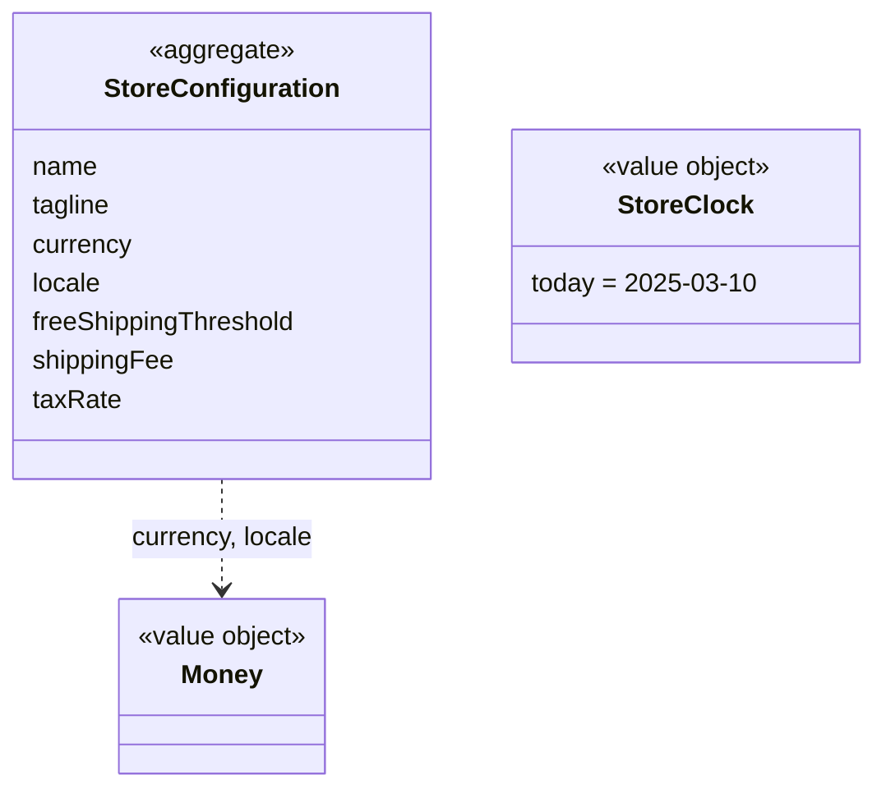

# StoreConfig context

## Purpose

StoreConfig holds the settings that make one deployment of HexCommerce a particular store: name, currency,
locale, the free-delivery threshold, the delivery fee and the tax rate. It also owns the two value types
every other context shares: **money** and the **store clock**.

## Strategic classification

| Aspect | Value |
| --- | --- |
| Subdomain | `SD-STORE-CONFIGURATION` (generic) |
| Business objectives served | BO-08 |
| Domain role | Specification: other contexts read it and never change it |
| Owner | Store operator |

## Responsibilities

**This context is responsible for:**
- the store's settings and their defaults;
- rounding and formatting money in the configured currency and locale;
- what "today" is for every date-dependent rule.

**This context is deliberately not responsible for:**
- *using* the delivery and tax settings to price a basket. That is owned by
  [Shopping](../shopping/README.md).
- the visual theme (`src/lib/theme.ts`). It is presentation, so the ontology leaves it out.

## Model overview

| Aggregate | In one line | File |
| --- | --- | --- |
| `StoreConfig.StoreConfiguration` | The deployment's settings, read once at build time | [aggregates/store-configuration.md](aggregates/store-configuration.md) |

## Contents

| File | What it holds |
| --- | --- |
| [ubiquitous-language.md](ubiquitous-language.md) | Terms of this context and their code identifiers |
| [aggregates/](aggregates/) | `StoreConfiguration` |
| [value-objects.md](value-objects.md) | `Money`, `StoreClock` (shared kernel) |
| [business-rules.md](business-rules.md) | Defaults, rounding, formatting, the fixed clock |
| [use-cases.md](use-cases.md) | Actor goals this context serves, step by step |
| [commands.md](commands.md) | Configuring the store |
| [domain-events.md](domain-events.md) | None |
| [read-models.md](read-models.md) | `StoreSettings`, `PriceDisplay` |

## Relationships

| REL | Direction | Other context | Pattern | What crosses |
| --- | --- | --- | --- | --- |
| REL-01 | upstream of | every other context | Shared Kernel (`Money`, `StoreClock`) + CF (settings) | `src/lib/format.ts`, `src/lib/site.ts` |

## Actors

| Actor | What they do here |
| --- | --- |
| ACT-STORE-OPERATOR | `StoreConfig.ConfigureStore` |

## Code map

| Concept | Code location | Notes |
| --- | --- | --- |
| `StoreConfig.StoreConfiguration` | `src/lib/site.ts` (`siteConfig`) | Read from `NEXT_PUBLIC_*` environment variables |
| `StoreConfig.Money` | `src/lib/format.ts` (`roundMoney`, `formatPrice`, `splitPrice`) | Amounts are plain `number`s |
| `StoreConfig.StoreClock` | `src/lib/format.ts` (`REFERENCE_TODAY`, `daysFromReference`) | Fixed date |

### Implementation notes

- `shippingFee` is a constant (5.99) in `siteConfig`, not an environment variable, so it cannot be
  configured without changing code.
- Theme presets and colour overrides are environment-driven too (`NEXT_PUBLIC_THEME*`), but they are
  presentation and are deliberately left out of this ontology.

## Known gaps

| Gap | Rules | Impact |
| --- | --- | --- |
| The clock is fixed rather than real time in a store time zone | CFG-BR-005 | Deals never start or end by themselves; delivery dates are always relative to 10 March 2025 |
| The delivery fee cannot be configured | CFG-BR-002 | Re-pricing delivery needs a code change (BO-08) |
| No next-day cut-off time or returns window setting | CFG-BR-002 | Needed by BRD rules BR-ORD-002 and BR-ORD-006 |

## Open questions

| ID | Question | Raised | Owner |
| --- | --- | --- | --- |
| CFG-Q-01 | The code defaults to USD and `en-US`; the BRD assumes the UK. Which is the reference market? | 2026-10-27 | Business Sponsor |
