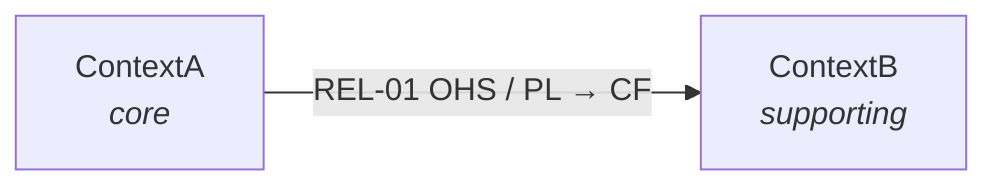

# Context map

<!--
How the bounded contexts relate. Pattern names and abbreviations: 00-meta/conventions.md §7.
Upstream (U) = the context whose model the other depends on. Downstream (D) = the dependent one.
Direction is about MODEL dependency, not about who calls whom.
-->

## Diagram

<!-- Edge label format: "U → D : PATTERN(s)". Keep node IDs equal to context names. -->

## Relationships

<!--
One row per directed relationship. "Contract" = what crosses the boundary (API, event, shared type).
"Translation" = where D converts U's model into its own (ACL), or "none" if conformist.
-->

| ID | Upstream | Downstream | Pattern | Contract (what crosses) | Translation | Code |
| --- | --- | --- | --- | --- | --- | --- |
| REL-01 | [<ContextA>](../03-bounded-contexts/<context-a>/README.md) | [<ContextB>](../03-bounded-contexts/<context-b>/README.md) | OHS + PL → CF | `<ContextA>.<ReadModel>` | none | `<path>` |

## Shared kernel

<!-- If any part of the model is shared, list exactly what and who may change it. Otherwise say "None". -->

None.

## Integration style

<!-- How integration is realised today: in-process calls, HTTP APIs, message bus, shared database… -->

## Known issues

<!-- Relationships that hurt: cycles, leaky models, missing translation, chatty calls. -->
