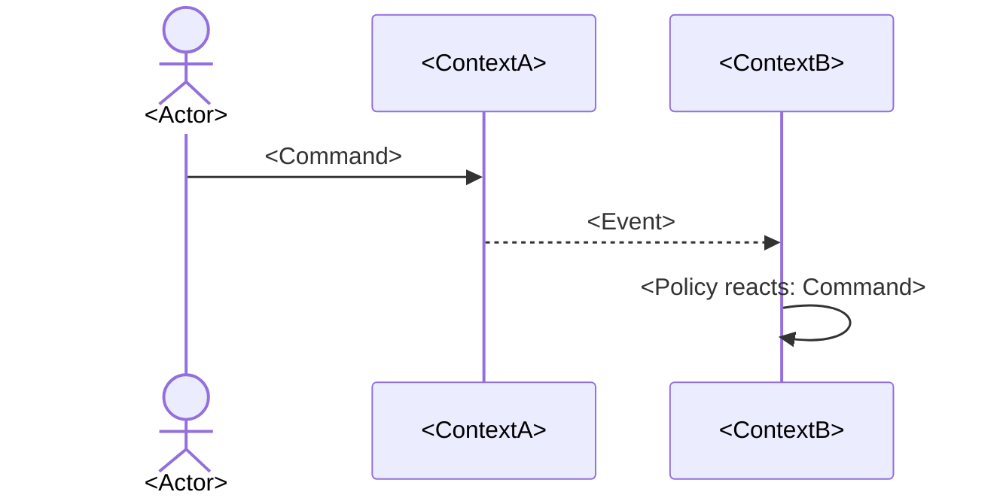

# Cross-context flows

<!--
End-to-end business journeys that cross bounded contexts. Model each as a chain of
command → event → policy → command. Intra-context behaviour belongs in the context folder, not here.
-->

## FLOW-01 <Name of the journey>

- **Trigger:** <What starts it, and which actor>
- **Outcome:** <Business result when it succeeds>
- **Contexts:** <ContextA>, <ContextB>
- **Relationships used:** REL-01

| Step | Context | Command / event / policy | Rules applied |
| --- | --- | --- | --- |
| 1 | <ContextA> | `<ContextA>.<Command>` | <CTX>-BR-001 |

**Failure paths:** <What happens when a step is rejected, and what stays consistent>
